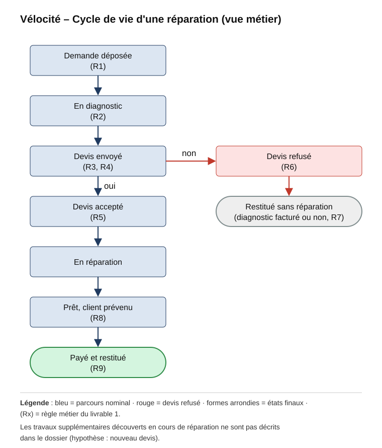
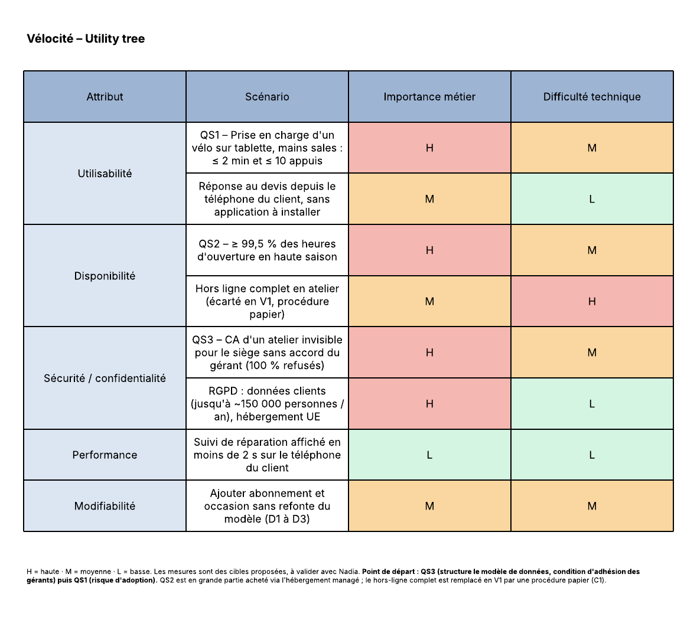

# Partie B — Mises en situation

## Usage de l'IA

J'ai utilisé l'assistant Claude (Anthropic), via l'outil Claude Code, pour trois tâches : extraire le texte brut du dossier Vélocité afin de ne perdre aucun chiffre, proposer une première version des tableaux de chaque livrable, et produire le schéma de l'utility tree dans Lucid. J'ai ensuite relu chaque affirmation en la comparant au dossier. Cette relecture m'a conduit à supprimer des règles métier que l'IA avait inventées (par exemple sur les vélos électriques, les avenants, les photos ou la durée de validité des devis) et à ajouter une colonne « Source » qui distingue ce que dit le dossier de ce que j'en déduis. Les hypothèses chiffrées, les arbitrages et la réponse à Nadia relèvent de mon propre jugement.

## Situation 1 — Vélocité (projet neuf)

### Ce que j'ai compris

* Vélocité est un réseau de **40 ateliers** de réparation de vélos en France, organisé en **franchise** : chaque atelier appartient donc à un **gérant indépendant**. Le siège compte **8 personnes**.
* Aujourd'hui, le client appelle pour déposer son vélo, et personne ne sait ensuite quand il sera prêt. Les gérants travaillent **sur cahier ou sur Excel**, et le paiement se fait **sur place, souvent en espèces**. Par conséquent, le réseau perd des clients et le siège n'a aucune vision de l'activité.
* Nadia Rahmani, directrice du réseau, veut une application qui offre trois choses : au client, la demande de réparation, le devis, le suivi et le **paiement en ligne** ; au gérant, le **planning** de son atelier ; au siège, les **chiffres du réseau**. Les **vélos électriques** doivent aussi être pris en charge.
* Les chiffres clés sont les suivants : **environ 60 réparations par atelier et par semaine en saison**, soit 2 400 par semaine sur l'ensemble du réseau ; un **budget de 90 000 €** ; une mise en service attendue **au printemps**, c'est-à-dire au début de la haute saison.
* Trois points sont sensibles : il n'y a **aucun informaticien** en interne, **quelques gérants refusent que le siège voie leur chiffre d'affaires**, et les mécaniciens travaillent sur une **tablette, les mains sales**.

---

### Ce qui manque : hypothèses et informations manquantes

Le dossier laisse plusieurs points flous. Pour chacun, je cite l'extrait concerné, je pose une hypothèse et j'indique ce qui changerait si elle se révélait fausse. Dans tout le document, le symbole 🤔 signale une information incertaine : elle ne figure pas dans le dossier et reste à valider avec Nadia et les gérants.

<div class="tableau-long">

| Information manquante (extrait du dossier) | Hypothèse retenue | Ce qui change si elle est fausse |
|---|---|---|
| « **Environ** 60 par atelier et par semaine en saison, **beaucoup moins** l'hiver » | On suppose une saison de 26 semaines à 60 réparations par semaine, puis 25 réparations par semaine le reste de l'année, ce qui donne **environ 88 000 réparations par an**. | L'impact serait faible : même avec un volume cinq fois plus élevé, la charge resterait modeste (voir le livrable 6). |
| « **Peut-être** 150 000 personnes passent chez nous » | Ce chiffre ne correspond pas aux 88 000 réparations par an ; il compte donc probablement aussi les passages sans réparation (achats, conseils). C'est pourquoi la charge est calculée à partir des réparations, tandis que la protection des données (RGPD) est prévue pour 150 000 personnes. | Il faudrait revoir le coût des SMS et le volume de données personnelles à protéger. |
| « Prêt pour le printemps » | L'application est en service dans les 40 ateliers **avant le 20 mars 2027**, soit dans environ 21 semaines, et un pilote a lieu avant cette date. | Si « printemps » signifie avril, l'équipe gagne deux semaines de marge. |
| « Budget : 90 000 € » : le fonctionnement est-il inclus ? | Les 90 k€ couvrent uniquement la **réalisation de la V1**. L'hébergement, les SMS et la maintenance sont payés à part, chaque mois. | Si le budget inclut aussi le fonctionnement, il faut réduire encore le périmètre de la V1. |
| Devis « **à la tête du client**. Enfin, selon une grille » | Le mécanicien peut s'écarter de la grille de prix de l'atelier, mais **chaque écart est enregistré** afin de pouvoir être contrôlé. | Si le siège veut interdire ces écarts, il faut ajouter un plafond ou une validation par le gérant. |
| « **Parfois** on facture le diagnostic, parfois non » | Chaque **atelier** fixe sa propre règle ; c'est donc un paramètre réglable atelier par atelier. | Si le siège impose une règle unique pour tout le réseau, ce paramètre devient commun à tous les ateliers. |
| « Quelques-uns ne veulent pas que le siège voie leur CA » | Le siège voit les **indicateurs d'activité** de tous les ateliers, mais le **chiffre d'affaires** d'un atelier n'apparaît **qu'avec l'accord de son gérant**. | Si le contrat de franchise impose la transparence, le paramétrage devient plus simple, mais la résistance des gérants risque d'augmenter. |
| Vélos électriques, « des pièces spécifiques » : le dossier n'en dit pas plus | La seule différence connue concerne les **pièces**. On prévoit donc un type « électrique » sur la fiche du vélo et des pièces dédiées dans la grille de prix. | Si le tarif de main-d'œuvre, les compétences requises ou la garantie constructeur diffèrent aussi, il faudra ajouter des règles. |
| Paiement en ligne : avant ou après la réparation ? Les espèces restent-elles acceptées ? | Le client paie en ligne **quand son vélo est prêt**, et le paiement sur place est **maintenu**. | Si Vélocité veut un acompte à la commande, il faut ajouter un module de paiement supplémentaire. |
| Outil d'encaissement actuel des ateliers (sujet **jamais abordé**) | En V1, l'encaissement sur place reste en dehors de l'application (voir le compromis C2). | Si les ateliers n'ont pas de caisse conforme à la loi, il faut intégrer une caisse certifiée, ce qui ajoute du coût et du délai. |
| Équipement : « une tablette dans l'atelier ». Y a-t-il du Wi-Fi ? | On suppose que chaque atelier dispose déjà d'une tablette et d'une connexion internet. | Dans le cas contraire, il faut compter environ 400 € de matériel par atelier, soit **16 k€** pour le réseau. |
| Travaux supplémentaires découverts pendant la réparation (sujet **jamais abordé**) | Ces travaux sont traités comme un **nouveau devis**, que le client accepte ou refuse selon le même mécanisme. | S'il existe déjà une procédure différente, il faut l'ajouter au cycle de vie de la réparation. |
| Fournisseurs de pièces : catalogues, échanges informatiques (sujet **jamais abordé**) | Les échanges avec les fournisseurs sont hors de la V1 ; on pose seulement un référentiel commun des pièces (décision D2). | Si la centralisation des achats devient urgente, les fonctionnalités de la V3 doivent passer avant celles de la V2. |
| « On n'a pas d'informaticien. On pensait que vous… » | Vélocité signe avec l'ESN un **contrat de maintenance**, en plus du budget de réalisation. | Sans maintenance, l'application se dégrade dès la première évolution, car personne en interne ne peut la corriger. |
| « Un abonnement entretien annuel. Et **peut-être** des vélos d'occasion » | Ces offres sont prévues en V3, mais l'architecture les prépare dès la V1 (décisions D1 et D3). | Si on les avance au printemps, ni le budget ni le délai ne peuvent être tenus. |

</div>

---

### Livrable 1 — Règles métier

Chaque règle indique sa source, afin de distinguer les faits du dossier de mes déductions :
* **Dossier** : la règle est écrite dans le mail ou dans le compte rendu ;
* **Déduite** : la règle se lit dans le discours des interlocuteurs, mais n'est pas dite explicitement ;
* **🤔** : la règle est incertaine et doit être validée avec Nadia et les gérants.

| # | Règle | Source |
|---|---|---|
| R1 | Le client dépose une demande de réparation, aujourd'hui par téléphone et demain dans l'application. | Dossier (mail et compte rendu « Comment ça marche ») |
| R2 | Un mécanicien examine le vélo **avant** d'établir le devis. | Dossier (« le mécanicien regarde, appelle pour le devis ») |
| R3 | Le mécanicien établit le devis selon la **grille de prix de son atelier**, car chaque atelier a sa propre grille. | Dossier (« chaque atelier a la sienne ») |
| R4 | Le mécanicien peut s'écarter de la grille. **🤔** Il reste à savoir si cet écart est libre, plafonné ou soumis à la validation du gérant. | Dossier (« à la tête du client ») et 🤔 |
| R5 | La réparation ne commence **qu'après l'accord du client** sur le devis. | Déduite (« appelle pour le devis, répare ») |
| R6 | Si le client refuse le devis, il récupère son vélo sans réparation. | Dossier |
| R7 | En cas de refus, le diagnostic est facturé ou non. **🤔** Il reste à savoir qui décide : l'atelier, le mécanicien, ou chacun au cas par cas. | Dossier (« parfois ») et 🤔 |
| R8 | Le client est prévenu quand son vélo est prêt. | Dossier (« rappelle quand c'est prêt ») |
| R9 | Le client paie sa réparation, aujourd'hui sur place (souvent en espèces) et demain aussi en ligne. **🤔** Il reste à savoir si le paiement en ligne a lieu avant la réparation ou à la restitution du vélo. | Dossier (compte rendu et mail) et 🤔 |
| R10 | Les vélos électriques nécessitent des **pièces spécifiques**. **🤔** Il reste à savoir s'il existe d'autres différences (tarif, compétences, garantie). | Dossier (mail) et 🤔 |
| R11 | Chaque atelier commande ses pièces **chez son propre fournisseur**, mais le siège souhaite centraliser ces achats plus tard. | Dossier |
| R12 | Chaque atelier ne voit que **ses propres** réparations et son propre planning, puisque chaque gérant est indépendant. | Déduite (franchise, « les gérants doivent voir leur planning ») |
| R13 | Le siège voit les chiffres du réseau, mais le **chiffre d'affaires d'un atelier n'est visible qu'avec l'accord de son gérant**. **🤔** Il reste à vérifier ce que prévoit le contrat de franchise. | Dossier (mail, compte rendu « Les gérants ») et Déduite |

Le **cycle de vie d'une réparation** ci-dessous est construit uniquement à partir des règles R1 à R9 ; il n'ajoute donc aucune étape absente du dossier.



---

### Livrable 2 — Contraintes non négociables

| Contrainte (source) | Famille | Ce qu'elle élimine d'office |
|---|---|---|
| **90 000 €** (mail) | Budget | Elle exclut le développement de trois applications séparées (iOS, Android et web), le développement maison de briques que l'on peut acheter (paiement, envoi de SMS), ainsi que l'abonnement, l'occasion et la centrale d'achat dès la V1. |
| **Prêt pour le printemps**, c'est-à-dire au début de la haute saison (mail) | Délai | Elle exclut un déploiement sur les 40 ateliers d'un seul coup en pleine saison, tout périmètre qui dépasse le parcours « demande, devis, réparation, paiement », et toute technologie que l'équipe ne maîtrise pas déjà. |
| **Aucun informaticien** chez Vélocité (compte rendu « Qui maintiendra ? ») | Équipe | Elle exclut un serveur hébergé dans les ateliers ou au siège, une architecture lourde à exploiter (microservices, Kubernetes) et tout composant qui demande une administration quotidienne. Elle impose donc un hébergement géré par un prestataire et un contrat de maintenance. |
| **Franchise avec des gérants indépendants**, dont certains refusent de montrer leur chiffre d'affaires (compte rendu) | Organisation | Elle exclut une grille de prix nationale imposée et un accès du siège au chiffre d'affaires d'un atelier sans l'accord de son gérant. Elle impose donc un paramétrage par atelier et des droits d'accès fins. |
| **RGPD** : données personnelles de clients, jusqu'à environ 150 000 personnes par an (compte rendu) | Loi | Elle exclut le stockage des données hors de l'Union européenne sans garanties, leur conservation sans limite de durée et l'envoi de SMS commerciaux sans consentement. |
| **Paiement en ligne** demandé (mail), soumis à la directive DSP2 et à la norme PCI-DSS | Loi | Elle exclut que l'application stocke elle-même les numéros de carte. Elle impose donc de passer par un prestataire de services de paiement (PSP). |
| **Loi anti-fraude à la TVA**, qui s'applique à tout logiciel enregistrant des paiements de particuliers ; or les ateliers encaissent sur place, souvent en espèces (compte rendu) | Loi | Elle exclut un module d'encaissement développé sur mesure et non certifié. |
| **Tablette utilisée les mains sales** par les mécaniciens, et **téléphone** pour les clients (compte rendu « Quel appareil ? ») | Technique | Elle exclut les interfaces pensées pour un ordinateur (saisie longue, petits boutons) ainsi qu'une application client qu'il faudrait installer. |

---

### Livrable 3 — Exigences fonctionnelles (user stories)

#### Ce qui doit être prêt au printemps (V1)

| # | User story | Source |
|---|---|---|
| US1 | En tant que **client**, je veux déposer une demande de réparation depuis mon téléphone, afin de ne plus avoir à appeler l'atelier. | Mail, compte rendu |
| US2 | En tant que **mécanicien**, je veux enregistrer la prise en charge d'un vélo sur la tablette en quelques gestes, afin de pouvoir le faire même avec les mains sales. | Compte rendu « Quel appareil ? » |
| US3 | En tant que **mécanicien**, je veux établir un devis à partir de la grille de prix de mon atelier, afin de chiffrer vite et de façon cohérente. | R3 |
| US4 | En tant que **client**, je veux recevoir le devis sur mon téléphone et l'accepter ou le refuser, afin de ne pas dépendre de l'appel de l'atelier. | R2, R5, R6 |
| US5 | En tant que **client**, je veux suivre l'avancement de ma réparation, afin de savoir quand mon vélo sera prêt. | Mail (« personne ne sait quand il sera prêt ») |
| US6 | En tant que **client**, je veux être prévenu quand mon vélo est prêt, afin de venir le récupérer au bon moment. | R8 |
| US7 | En tant que **client**, je veux payer ma réparation en ligne, afin de ne pas avoir à payer au comptoir. | Mail, R9 |
| US8 | En tant que **gérant**, je veux voir le planning de mon atelier, afin de répartir le travail entre les mécaniciens. | Mail |
| US9 | En tant que **gérant**, je veux paramétrer ma grille de prix et ma règle de facturation du diagnostic, afin d'appliquer les choix propres à mon atelier. | R3, R7 |
| US10 | En tant que **mécanicien**, je veux indiquer qu'un vélo est électrique et choisir ses pièces spécifiques dans le devis, afin que le devis soit juste. | Mail, R10 |
| US11 | En tant que **dirigeant du siège**, je veux voir, pour chaque atelier, le nombre de réparations, le délai moyen et le taux de devis acceptés, afin de piloter le réseau. | Mail (« les chiffres de tout le réseau ») |
| US12 | En tant que **gérant**, je veux décider si le siège peut voir mon chiffre d'affaires, afin de garder le contrôle sur mes données financières. | Compte rendu « Les gérants », R13 |

#### Ce qui peut attendre (V2 et V3)

| # | User story | Source |
|---|---|---|
| US13 | En tant que **client**, je veux retrouver l'historique des réparations de mon vélo, afin de connaître son état d'entretien. | Préparation de l'abonnement |
| US14 | En tant que **dirigeant du siège**, je veux voir le chiffre d'affaires consolidé des ateliers qui ont accepté de le partager, afin de suivre la performance financière du réseau. | Mail, R13 |
| US15 | En tant que **gérant**, je veux commander mes pièces par l'intermédiaire d'une centrale d'achat du siège, afin de bénéficier de meilleures conditions. | Compte rendu « Les pièces » |
| US16 | En tant que **client**, je veux souscrire un abonnement d'entretien annuel, afin de faire entretenir mon vélo régulièrement. | Compte rendu « Et après ? » |
| US17 | En tant que **client**, je veux acheter un vélo d'occasion révisé par le réseau, afin d'acheter un vélo fiable à moindre coût. | Compte rendu « Et après ? » |

---

### Livrable 4 — Scénarios de qualité et utility tree

Les mesures ci-dessous sont des **cibles que je propose** et que Nadia doit valider ; elles ne proviennent pas du dossier.

| # | Attribut | Qui | Quoi | Quand | Mesure |
|---|---|---|---|---|---|
| QS1 | Utilisabilité | Un mécanicien, sur la tablette de l'atelier, les mains sales | enregistre la prise en charge d'un vélo (client, vélo, problème décrit) | un samedi de haute saison, avec des clients qui attendent | La saisie prend au plus 2 minutes et 10 appuis en médiane, mesurés sur les ateliers pilotes. |
| QS2 | Disponibilité | Un mécanicien ou un gérant | ouvre l'application pour prendre en charge ou rendre un vélo | pendant les heures d'ouverture en haute saison (horaires à confirmer) | L'application est disponible au moins 99,5 % du temps d'ouverture. En cas de panne, l'atelier passe à une procédure papier, puis ressaisit les données en moins de 10 minutes. |
| QS3 | Confidentialité | Un utilisateur du siège | tente d'afficher le chiffre d'affaires d'un atelier dont le gérant a refusé le partage | à tout moment | Toutes les tentatives sont refusées et enregistrées dans un journal ; des tests automatiques le vérifient à chaque livraison. |

**Utility tree** : chaque scénario porte deux notes, l'importance pour le métier puis la difficulté technique, sur l'échelle H (haute), M (moyenne) et L (basse).



#### Par où commencer : QS3, puis QS1.
* **QS3 vient en premier, car il structure le modèle de données.** Le cloisonnement des données par atelier doit être décidé dès le premier jour ; l'ajouter après coup obligerait à refondre la base. De plus, ce cloisonnement est la condition pour que les gérants réticents acceptent l'outil (compte rendu).
* **QS1 vient ensuite, car il porte le risque d'adoption.** Si la saisie est pénible sur une tablette avec les mains sales, les mécaniciens reviendront au cahier. C'est pourquoi on la teste sur une maquette avec deux ou trois mécaniciens avant d'écrire le code.
* **QS2 se règle en grande partie par l'achat d'un hébergement géré** par un prestataire, qui garantit la disponibilité. En revanche, le fonctionnement complet hors connexion, noté (M, H), est écarté en V1 : il coûterait cher, et une procédure papier suffit en cas de panne (voir le compromis C1).

---

### Livrable 5 — Compromis

| # | Choix retenu | On gagne | On perd | Pourquoi, d'après le dossier |
|---|---|---|---|---|
| C1 | **Une application web adaptée au mobile (PWA)** plutôt que des applications natives | On ne maintient qu'une seule base de code pour le téléphone du client et la tablette de l'atelier, on évite la publication sur les magasins d'applications, et les mises à jour sont immédiates. | Le fonctionnement hors connexion est limité, et les notifications push sont restreintes sur iOS. | Un budget de 90 k€ et un délai d'environ 21 semaines ne permettent pas de développer trois applications. Les clients sont donc prévenus par SMS ou par email, et une procédure papier remplace le mode hors connexion. |
| C2 | **Le paiement en ligne passe par un prestataire de paiement (PSP), et l'encaissement sur place reste hors de l'application en V1** | On respecte les obligations légales (PCI-DSS, loi anti-fraude) sans développer de caisse, et on tient le délai. | Le siège ne voit pas le chiffre d'affaires encaissé sur place, et le personnel utilise deux outils au comptoir. | Nadia demande le paiement en ligne, mais les espèces restent courantes, et développer une caisse certifiée dépasse le budget. Ce choix rejoint d'ailleurs la réticence des gérants à montrer leur chiffre d'affaires. |
| C3 | **Chaque atelier a sa propre grille de prix**, construite sur un **référentiel commun de prestations** | On obtient l'adhésion des gérants et on respecte le principe de la franchise. | Les prix ne sont pas harmonisés, et il devient plus difficile de les comparer entre ateliers. | Le dossier indique que « chaque atelier a la sienne », et certains gérants résistent déjà. Le référentiel commun permet néanmoins au siège de comparer les volumes et les délais. |

---

### Livrable 6 — Calcul de charge

**Donnée du dossier** : 40 ateliers × 60 réparations par semaine en saison = **2 400 réparations par semaine**.

#### Hypothèses que je pose, car le dossier ne les fournit pas
* Une réparation génère environ 16 actions : la demande, la prise en charge, le devis, la consultation et la réponse du client, trois changements de statut, environ quatre consultations du suivi par le client, puis le paiement. Comme une action correspond à environ 5 requêtes HTTP, une réparation génère **environ 80 requêtes**.
* L'usage sans lien direct avec une réparation (planning, tableaux de bord) représente environ 50 actions par jour et par atelier. Cela donne 50 actions × 5 requêtes × 6 jours × 40 ateliers = **60 000 requêtes par semaine**.
* Les ateliers sont ouverts 6 jours sur 7, 10 heures par jour, soit 216 000 secondes par semaine.

#### Calcul

```
Requêtes par semaine = 2 400 × 80 + 60 000 = 252 000
Moyenne              = 252 000 / 216 000   ≈ 1,2 req/s
Pic                  = 1,2 × 5 (samedi matin) × 2 (semaine de rush) ≈ 12 req/s
```

**Conclusion : la charge n'est pas un sujet.** En effet, une petite instance applicative traite plusieurs centaines de requêtes par seconde, soit bien plus que les 12 requêtes par seconde du pic estimé. Les vrais risques se situent donc ailleurs :
* la **disponibilité** de l'application en haute saison ;
* la **confidentialité** des données entre les ateliers et le siège ;
* l'**adoption** de l'outil par les mécaniciens.

Par conséquent, investir dans la capacité de montée en charge (cache distribué, microservices) serait inutile.

---

### Livrable 7 — V1 / V2 / V3

| Version | Échéance proposée | Périmètre |
|---|---|---|
| **V1** | Un pilote sur 3 ateliers à la mi-février 2027, puis un déploiement sur les 40 ateliers avant le 20 mars 2027 | La demande de réparation, la prise en charge, le devis selon la grille de l'atelier (vélos électriques compris), la réponse du client, le suivi, la notification « vélo prêt », le paiement en ligne, le planning de l'atelier, les indicateurs d'activité pour le siège, le partage du chiffre d'affaires au choix du gérant et la gestion des rôles. |
| **V2** | Été et automne 2027 | L'historique du vélo côté client, le chiffre d'affaires consolidé des ateliers volontaires et, si nécessaire, l'intégration de l'encaissement sur place (voir le compromis C2). |
| **V3** | 2028 | L'abonnement d'entretien annuel, la vente de vélos d'occasion révisés et la centralisation des achats de pièces. |

#### Décisions prises dès la V1 pour préparer la V3

Ces décisions ne construisent pas la V3, mais elles évitent qu'elle impose une refonte coûteuse.

| # | Décision prise en V1 | Coût en V1 | Ce qu'elle rend possible en V3 |
|---|---|---|---|
| D1 | Le **vélo est enregistré comme une entité à part entière** (identifiant, numéro de cadre, marque, électrique ou non), et non comme un simple champ texte de la demande. | Ce coût est presque nul. | Pour l'**abonnement**, l'entretien peut être rattaché au vélo. Pour l'**occasion**, un vélo révisé dispose d'un historique traçable. |
| D2 | On crée un **référentiel commun des prestations et des pièces** (codes communs au réseau), même si les prix et les fournisseurs restent propres à chaque atelier. | Il faut compter quelques jours de cadrage. | Pour la **centralisation des achats**, le siège connaît déjà la consommation réelle de chaque pièce et peut donc négocier avec les fournisseurs. |
| D3 | Chaque **client est unique à l'échelle du réseau**, et on choisit un prestataire de paiement capable de gérer le **paiement récurrent**. | Ce coût est faible. | L'**abonnement** est valable dans tout le réseau, sans migration des clients ni changement de prestataire de paiement. |

---

### Livrable 8 — Réponse à Nadia

> Bonjour Nadia,
>
> Le budget de 90 000 € et l'échéance du printemps sont **tenables, à condition de réduire la V1** au parcours principal : la demande, le devis, le suivi, le paiement en ligne, le planning de l'atelier et le tableau de bord du réseau.
> J'estime la réalisation à **70 à 80 k€**, auxquels s'ajoute une réserve de **10 à 15 k€** pour le pilote, la formation et les imprévus. Il faudra ensuite prévoir **environ 1 à 2 k€ par mois** pour l'hébergement, les SMS et la maintenance, ainsi que la commission du prestataire de paiement.
> Le calendrier serait le suivant : cadrage en novembre, pilote sur 3 ateliers à la mi-février, puis déploiement sur les 40 ateliers avant le 20 mars.
> D'autres fonctions **peuvent attendre** : l'historique client et le chiffre d'affaires consolidé en V2 (environ 40 à 60 k€), puis l'abonnement, l'occasion et les achats centralisés en V3 (environ 80 à 120 k€).
> Ces chiffres reposent sur plusieurs hypothèses : environ 88 000 réparations par an, des prix propres à chaque atelier, des espèces encore encaissées en atelier, ainsi qu'une tablette et une connexion internet dans chaque atelier.
> Enfin, trois arbitrages vous reviennent avant de démarrer : ce que le siège doit obligatoirement voir, qui décide de facturer le diagnostic, et ce qui distingue un vélo électrique en dehors des pièces.

---

### Ce que je refuse de faire, et pourquoi

| Je refuse de… | Parce que… |
|---|---|
| promettre l'abonnement, l'occasion et la centrale d'achat pour le printemps, | un budget de 90 k€ et un délai d'environ 21 semaines ne suffisent pas. Je les prépare donc par les décisions D1 à D3, sans les construire. |
| développer une caisse ou stocker des numéros de carte bancaire, | la loi impose une caisse certifiée et le recours à un prestataire de paiement. De plus, ce n'est pas le cœur du métier de Vélocité. |
| donner au siège l'accès au chiffre d'affaires d'un atelier sans l'accord de son gérant, | cette décision relève du contrat de franchise et de Nadia, et non de l'architecte. Imposer cet accès sans le dire ferait en outre échouer l'adoption de l'outil. |
| inventer les règles sur les vélos électriques ou sur la facturation du diagnostic, | le dossier ne les donne pas. Je pose donc des hypothèses et je les fais valider (règles R7 et R10). |
| déployer l'application sur les 40 ateliers d'un seul coup, en pleine saison, | un problème toucherait alors tout le réseau au pire moment. C'est pourquoi je passe d'abord par un pilote sur 3 ateliers. |
| livrer l'application sans contrat de maintenance, | Vélocité n'a aucun informaticien. Sans suivi, l'application se dégraderait donc dès la première évolution. |
