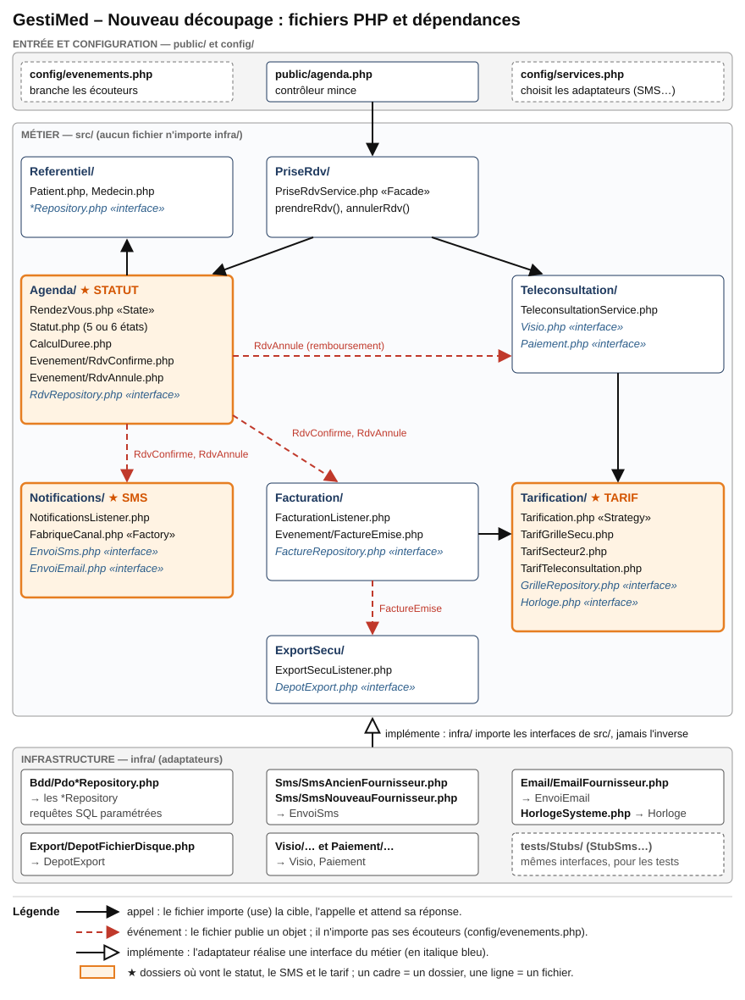

# Partie B — Mises en situation

## Usage de l'IA

J'ai utilisé l'assistant Claude (Anthropic), via l'outil Claude Code, pour trois tâches : extraire le texte brut du dossier GestiMed et de l'extrait d'`agenda.php`, proposer une première version du diagnostic et des tableaux, et dessiner les schémas (en blocs de texte, et en image pour le découpage en fichiers). J'ai ensuite comparé chaque problème relevé à l'extrait, ligne par ligne ; cette vérification m'a notamment permis de corriger le nombre de requêtes SQL vulnérables. J'ai aussi marqué d'un **🤔** toutes les règles que le dossier ne tranche pas (facture annulée, statuts, secteurs). Le choix des patterns, l'ordre des travaux et les refus relèvent de mon propre jugement.

## Situation 2 — GestiMed (projet existant)

### Ce que j'ai compris

* GestiMed est un logiciel de gestion de cabinet médical (rendez-vous, rappels, facturation). Il est utilisé par **1 200 cabinets** et existe depuis **6 ans**.
* J'arrive comme tech lead avec **2 développeurs**, et l'auteur principal du code est parti. Le CTO veut un plan pour faire évoluer le code **sans tout réécrire**, car il n'a ni le temps ni l'équipe pour une réécriture.
* Le code est en mauvais état. Le fichier `agenda.php` fait **3 100 lignes** et mélange les rendez-vous, les SMS, la facturation et l'export vers la Sécurité sociale. Il n'existe **aucun test automatisé** (« on teste à la main, le vendredi »). Le fournisseur de SMS est appelé directement depuis **14 fichiers**, les tarifs sont dans un **tableau écrit en dur**, et le statut d'un rendez-vous est une **chaîne de caractères libre** : on a donc déjà vu un rendez-vous « annulé » redevenir « confirmé ».
* Quatre évolutions sont demandées cette année : la **téléconsultation** (avec un lien visio et un paiement en ligne), un **nouveau fournisseur de SMS** (car l'actuel ferme **dans 4 mois**), des **tarifs qui dépendent de la spécialité, du secteur et du type de consultation**, et un **rappel par email, au choix du patient**.
* Une contrainte domine toutes les autres : **une facture fausse provoque l'appel d'un médecin au support**. Or les factures sortent tous les jours ; rien ne doit donc casser pendant les travaux.

---

### Ce qui manque : hypothèses et informations manquantes

Le dossier laisse plusieurs points flous. Pour chacun, je cite l'extrait concerné, je pose une hypothèse et j'indique ce qui changerait si elle se révélait fausse. Dans tout le document, le symbole 🤔 signale une information incertaine : elle ne figure pas dans le dossier et reste à valider avec GestiMed.

<div class="tableau-long">

| Information manquante (extrait du dossier) | Hypothèse retenue | Ce qui change si elle est fausse |
|---|---|---|
| `medecin.flag2 == 1 → duree = 30` : « personne ne sait » à quoi sert ce champ | On **conserve ce comportement à l'identique** et on enquête : on regarde d'abord dans les données quels médecins ont `flag2 = 1`, puis on interroge le support et quelques cabinets. | Si `flag2` est utilisé ailleurs dans les 3 100 lignes, le renommer casserait ces usages. C'est pourquoi on fige d'abord son comportement par un test (T5). |
| « Le fournisseur de SMS est appelé directement depuis 14 fichiers » | `agenda.php` fait partie de ces 14 fichiers, et chaque appel envoie un SMS simple (un numéro et un texte). | S'il existe d'autres usages (accusés de réception, SMS groupés), la « prise » SMS devra aussi les couvrir, ce qui ajoute 1 à 2 semaines de travail. |
| Le nouveau fournisseur de SMS **n'est pas encore choisi** | Le CTO fait ce choix **au plus tard à la fin du deuxième mois**. | Si le choix arrive plus tard, la bascule devra se faire sans pilote, juste avant la fermeture de l'ancien fournisseur. |
| Le volume de rendez-vous **n'est jamais donné** | On suppose **environ 25 rendez-vous par cabinet et par jour**, soit environ 30 000 par jour pour l'ensemble des cabinets. | Le plan ne change pas. En revanche, le coût des SMS et le temps perdu à attendre l'envoi des SMS (problème P3 du diagnostic) changent. |
| `genererExportSecu` « écrit un fichier sur le disque du serveur » : on ne sait pas qui lit ce fichier | Un outil de télétransmission **existant** relit ce dossier chaque jour ; le format du fichier ne doit donc pas changer. | Si une personne récupère ce fichier à la main, le risque de perte est plus grand ; l'export deviendrait alors prioritaire dans l'ordre des travaux. |
| La facture est créée **dès la prise du rendez-vous**, et non après la consultation | C'est le fonctionnement actuel, et on le **conserve** tant que la direction et la comptabilité n'ont pas tranché **🤔**. | Si la facture doit être créée après la consultation, le module Facturation réagira à un autre événement (« rendez-vous honoré ») : seule une ligne de branchement change. |
| À l'annulation, le code exécute `DELETE FROM factures`, mais l'export vers la Sécurité sociale déjà généré n'est pas annulé | **🤔** Le traitement d'une facture annulée (suppression, avoir ou export correctif) doit être validé avec la comptabilité. | Si une facture déjà émise ne peut pas être supprimée, il faudra produire un avoir et un export correctif, ce qui ajoute un livrable. |
| Seul le cas `secteur == 2` est traité explicitement ; tous les autres cas utilisent la grille | On suppose que le secteur 1 suit la grille de la Sécurité sociale et que le secteur 2 applique le tarif libre du médecin. Les autres cas éventuels restent à vérifier **🤔**. | S'il existe d'autres secteurs ou options, on ajoute des stratégies de tarif (voir le livrable 5), sans réécrire le calcul. |
| La liste complète des statuts n'est pas connue : l'extrait ne montre que « confirmé » et quatre orthographes d'« annulé » | Les statuts cibles seraient : à confirmer, confirmé, honoré, absent et annulé **🤔**. | Si d'autres statuts existent dans la base, la migration des données devra aussi les reprendre. |
| Téléconsultation : les fournisseurs de visio et de paiement **ne sont pas choisis**, et on ignore si le tarif et l'export vers la Sécurité sociale sont différents **🤔** | On **achète** la visio et le paiement auprès de prestataires spécialisés, et le tarif de téléconsultation devient une stratégie de tarif supplémentaire. | Si la Sécurité sociale impose un circuit particulier pour la téléconsultation, il faudra adapter le module Export Sécu. |
| Le choix entre SMS et email : l'extrait ne contient **aucun champ** pour l'enregistrer | On ajoute au patient un champ « canal préféré », avec le SMS comme valeur par défaut. | Cette hypothèse n'a aucun impact sur l'architecture. |
| Données de santé : l'hébergement et la sécurité ne sont **jamais abordés** | **🤔** On suppose que l'hébergement est déjà conforme à la certification HDS (hébergeur de données de santé), et qu'aucun contenu médical n'apparaît dans les SMS ou les emails. | Dans le cas contraire, ce sujet passe avant toutes les évolutions, car il s'agit d'une obligation légale. |
| L'extrait est en pseudo-code : la **version de PHP** et l'outillage (Composer) ne sont **jamais donnés** **🤔** | On suppose PHP 8 avec Composer, dont le chargement automatique relie chaque namespace à un dossier (par exemple `use GestiMed\Agenda\RendezVous;`). | Sans Composer, un fichier de démarrage regroupe des `require_once` ; les dossiers et le sens des dépendances du livrable 4 restent identiques. |
| On ignore si les 2 développeurs connaissent `agenda.php` | On suppose qu'ils le connaissent en partie, et qu'ils en savent plus que moi sur l'histoire du code. | S'ils ne le connaissent pas, il faut prévoir 2 à 3 semaines supplémentaires pour lire le code existant et le tester. |

</div>

---

### Livrable 1 — Le diagnostic

J'ai relevé douze problèmes dans l'extrait. Ils sont classés du plus grave au moins grave.

<div class="tableau-long">

| # | Problème (ligne de l'extrait) | Conséquence concrète | Principe violé |
|---|---|---|---|
| P1 | **Les requêtes SQL sont construites par concaténation**, par exemple `"SELECT * FROM patients WHERE id = " + requete.patient_id`. C'est le cas de 6 des 7 requêtes de l'extrait ; la septième (`INSERT INTO rdv`) est masquée par `(...)`. | C'est une **faille de sécurité (injection SQL)** : un `patient_id` forgé par un attaquant permet de lire ou d'effacer les **données de santé** des 1 200 cabinets. | La sécurité ; la séparation entre métier et technique, car du SQL brut se trouve au milieu des règles du cabinet. |
| P2 | La fonction `enregistrerRdv` fait **six choses** : elle calcule la durée, enregistre le rendez-vous, envoie le SMS, calcule le tarif, crée la facture et produit l'export vers la Sécurité sociale. | Pour changer le texte du SMS, il faut donc rouvrir la fonction qui calcule les factures, au risque de la casser. | Le **S** de SOLID, car la fonction répond à plusieurs « responsables » (secrétariat, comptabilité, Sécurité sociale) ; une **cohésion faible**, car le fichier de 3 100 lignes mélange tous les sujets. |
| P3 | `SMSProvider.envoyer(...)` est appelé directement, et l'appel **bloque pendant 2 secondes**. | Si le fournisseur tombe en panne, plus personne ne peut prendre de rendez-vous. De plus, avec environ 30 000 rendez-vous par jour (hypothèse), l'attente cumulée atteint environ 17 heures par jour. | Le **D** de SOLID, car le code métier connaît directement le fournisseur ; un **couplage par appel synchrone**, puisque le code appelle et attend. |
| P4 | Le même appel au SMS est recopié dans `annulerRdv`, et au total dans **14 fichiers**. | Changer de fournisseur oblige donc à modifier 14 fichiers, et un seul oubli suffit pour que des rappels ne partent plus, sans qu'aucune erreur ne s'affiche. | Le principe **DRY** ; un **couplage fort** avec le fournisseur. |
| P5 | Le tarif est lu dans `GRILLE_SECU[medecin.specialite]`, un **tableau écrit en dur** dans le code. | Chaque changement de tarif décidé par la Sécurité sociale oblige à modifier le code et à refaire une livraison. En outre, les anciens tarifs sont écrasés et disparaissent. | Le **O** de SOLID ; la séparation entre **métier et technique**, car une règle du cabinet se modifie comme du code. |
| P6 | Le calcul du tarif repose sur `si secteur == 2 … sinon GRILLE_SECU`. | Chaque nouveau critère (par exemple le type de consultation) ajoutera donc un `si` dans la fonction qui facture. | Le **O** de SOLID, car on doit rouvrir le code existant à chaque nouveauté. |
| P7 | La durée est calculée par une cascade de `si`, dont `flag2 == 1 → 30` (« personne ne sait »). | Cette règle du cabinet est **illisible** : il est impossible de dire si elle est juste. | La séparation entre **métier et technique**, car la règle n'a pas de nom ; le **O** de SOLID, car la téléconsultation ajoutera encore un `si`. |
| P8 | **Aucune vérification de chevauchement** n'est faite avant le `INSERT INTO rdv`. | Deux patients peuvent donc être placés sur le même créneau du même médecin. | La séparation entre **métier et technique** : la règle « un médecin ne reçoit pas deux patients en même temps » n'est écrite nulle part. |
| P9 | Le statut est une **chaîne libre**, écrite `"annule"`, `"annulé"`, `"ANNULE"` ou `"cancelled"` selon les endroits ; de plus, l'état de départ n'est jamais vérifié. | Une requête `WHERE statut = 'annule'` ignore donc les trois autres orthographes. Par ailleurs, un rendez-vous annulé peut redevenir « confirmé », et un rendez-vous déjà honoré peut être annulé. | Le principe **DRY**, car la valeur est recopiée partout ; la **cohésion**, car le cycle de vie du rendez-vous est éparpillé. |
| P10 | Le rendez-vous, la facture et l'export sont écrits **les uns après les autres, sans transaction**. | Si l'envoi du SMS échoue après le `INSERT INTO rdv`, on obtient un rendez-vous **sans facture**. Pourtant, la fonction répond `retourner "OK"` dans tous les cas. | Le **couplage** : une panne du SMS casse la facturation. |
| P11 | `genererExportSecu` **écrit un fichier sur le disque du serveur**. | On ne peut donc pas tester ce code sans disque, et le fichier est perdu si le serveur change. De plus, à l'annulation, l'export est déjà parti alors que la facture, elle, est supprimée. | Le **D** de SOLID, car le métier dépend du système de fichiers ; le **couplage**. |
| P12 | Dans `annulerRdv`, la facture est supprimée par `DELETE FROM factures`, et le SMS part **sans vérifier que le patient a un téléphone**, contrairement à `enregistrerRdv`. | Il ne reste donc plus aucune trace comptable de la facture, et un SMS peut partir vers un numéro vide. | La séparation entre **métier et technique**, car une règle comptable est cachée dans un `DELETE` ; le principe **DRY**, car la condition « le patient a un téléphone » n'est écrite qu'à un endroit sur deux. |

</div>

---

### Livrable 2 — Les quatre évolutions dans le code actuel

La cinquième ligne de l'énoncé (« une facture fausse = un médecin qui appelle le support ») n'est pas une évolution. C'est la **contrainte** qui permet de juger le risque des quatre autres.

| Évolution | Ce qu'il faudrait modifier aujourd'hui | Ce qui risque de casser |
|---|---|---|
| **La téléconsultation** (lien visio et paiement en ligne) | Il faudrait ajouter un `si type == "teleconsultation"` dans `enregistrerRdv` pour la durée, la visio et le paiement, ajouter un tarif dans le `si secteur`, prévoir un nouvel export vers la Sécurité sociale **🤔**, ajouter de nouveaux statuts (par exemple « en attente de paiement ») dans tous les fichiers qui manipulent la chaîne `statut`, et ajouter un remboursement dans `annulerRdv`. | **La facturation des consultations au cabinet** risque de casser, puisqu'elle se trouve dans la même fonction. Le cycle de vie (P9) recevrait une orthographe de plus. Un patient pourrait être débité sans rendez-vous si le `INSERT` échoue après le paiement (P10). Enfin, une téléconsultation annulée verrait sa facture supprimée sans que le paiement soit jamais remboursé. |
| **Le nouveau fournisseur de SMS** (dans 4 mois) | Il faudrait modifier les **14 fichiers** qui appellent `SMSProvider`, chacun à sa façon. | Un fichier oublié signifie des rappels qui ne partent plus, **sans erreur visible**. De plus, le nouveau fournisseur signale peut-être ses erreurs autrement, ce qui pourrait faire échouer l'enregistrement du rendez-vous (P10). |
| **Les tarifs selon la spécialité, le secteur et le type de consultation** | Il faudrait faire passer `GRILLE_SECU` à 2 ou 3 dimensions, faire grossir le `si secteur == 2`, et modifier tous les **autres endroits** des 3 100 lignes qui calculent un tarif **🤔**. | **Des factures fausses** pourraient apparaître dès le lendemain, ce qui est exactement le scénario redouté. Les montants des exports vers la Sécurité sociale seraient aussi touchés, ainsi que les factures déjà émises si la grille est écrasée sans date d'effet. |
| **Le rappel par email au choix du patient** | Il faudrait ajouter un champ de préférence, puis un `si email … sinon SMS` dans **chacun des 14 fichiers**. | Selon les fichiers, le patient pourrait recevoir deux messages ou aucun. L'annulation risquerait d'être oubliée, de sorte qu'un patient ayant choisi l'email recevrait encore un SMS. Enfin, chaque envoi ajouterait encore 2 secondes d'attente. |

**Constat** : les quatre évolutions passent toutes par `agenda.php`, et trois d'entre elles touchent la fonction qui produit les factures. Par conséquent, dans l'état actuel du code, chaque évolution met la facturation en danger.

---

### Livrable 3 — Métier et technique

**La partie technique de l'extrait** regroupe tout ce qui n'intéresse pas le médecin : les appels `BDD.executer(...)` et le SQL, l'appel `SMSProvider.envoyer`, le fichier écrit sur le disque, le tableau `GRILLE_SECU` en tant que structure de stockage, la chaîne de retour `"OK"`, le nom de colonne `flag2` et le format du texte du SMS.

**Les règles du cabinet**, à l'inverse, sont celles qu'un médecin comprendrait sans connaissances informatiques. Chaque règle indique sa source, afin de distinguer les faits du dossier de mes déductions :

* **Dossier** : la règle est écrite dans l'extrait ou dans l'énoncé ;
* **Déduite** : la règle se lit dans le discours, mais n'est pas dite explicitement ;
* **🤔** : la règle est incertaine et doit être validée.

| # | Règle métier | Source |
|---|---|---|
| RM1 | Une consultation chez un généraliste dure **15 minutes**. | Dossier (extrait) |
| RM2 | Une consultation chez un dermatologue dure **20 minutes**. | Dossier (extrait) |
| RM3 | Certains médecins ont des consultations de **30 minutes**. **🤔** Il reste à savoir lesquels, et pour quelle raison (champ `flag2`). | Dossier (extrait) et 🤔 |
| RM4 | Pour les autres spécialités, une consultation dure **20 minutes**. | Dossier (extrait) |
| RM5 | Un médecin ne reçoit pas deux patients sur le même créneau. **🤔** Il reste à vérifier si certains cabinets surréservent volontairement. | Déduite (l'absence de vérification du chevauchement est signalée comme un défaut) |
| RM6 | Le patient est prévenu de son rendez-vous par SMS, **à condition d'avoir un téléphone**. | Dossier (extrait) |
| RM7 | Le patient choisit d'être prévenu par SMS **ou** par email. | Dossier (évolutions demandées) |
| RM8 | Le patient est prévenu de l'annulation de son rendez-vous. | Dossier (extrait) |
| RM9 | Un médecin de **secteur 2** fixe son propre tarif. | Dossier (extrait) |
| RM10 | Dans les autres cas, le tarif est celui de la **grille de la Sécurité sociale pour la spécialité du médecin**. | Dossier (extrait) |
| RM11 | La grille change quand la Sécurité sociale la modifie, et une consultation est facturée au tarif en vigueur **à la date de la consultation**. | Dossier (« modifié à chaque changement de la Sécu ») et Déduite (la date d'effet) |
| RM12 | Le tarif dépendra de la spécialité, du secteur, puis du type de consultation. | Dossier (évolutions demandées) |
| RM13 | Chaque rendez-vous donne lieu à une facture **dès sa prise**. **🤔** Il reste à savoir si la facture ne devrait pas plutôt être créée après la consultation. | Dossier (extrait) et 🤔 |
| RM14 | Chaque facture est transmise à la Sécurité sociale. | Dossier (extrait) |
| RM15 | Un rendez-vous annulé ne peut pas redevenir confirmé. | Déduite (l'énoncé présente ce cas comme un bug) |
| RM16 | À l'annulation, la facture du rendez-vous disparaît. **🤔** Il reste à savoir s'il faut la supprimer ou émettre un avoir, et ce qu'il faut faire de l'export déjà envoyé à la Sécurité sociale. | Dossier (extrait) et 🤔 |
| RM17 | Une téléconsultation comporte un lien visio et se **paie en ligne**. | Dossier (évolutions demandées) |
| RM18 | Une téléconsultation payée puis annulée est remboursée. **🤔** Il reste à connaître le délai de remboursement. | 🤔 |

---

### Livrable 4 — Le nouveau découpage

Le découpage proposé est un **monolithe modulaire** : GestiMed reste une seule application PHP, livrée d'un seul bloc comme aujourd'hui, mais son code est réparti en modules. Chaque module correspond à un **dossier**, donc à un namespace PHP, et chaque bloc du schéma ci-dessous est un **fichier** de ce dossier. Ce choix respecte la contrainte d'équipe, car deux développeurs ne pourraient pas exploiter des microservices (voir les refus).

Le code est rangé en trois couches, selon le principe des ports et adaptateurs :

* `public/` contient le point d'entrée : `agenda.php` devient un contrôleur mince, qui lit la requête et appelle le métier ;
* `src/` contient le métier, c'est-à-dire les règles du cabinet, ainsi que des **interfaces** (les « ports ») qui décrivent ce dont le métier a besoin, par exemple `EnvoiSms` ou `RdvRepository` ;
* `infra/` contient les adaptateurs, c'est-à-dire le code qui parle à la base de données, au fournisseur de SMS, au disque, à la visio et au paiement.

La règle de dépendance est la suivante : **`infra/` importe `src/`, et jamais l'inverse**. Aucun fichier du métier ne contient donc de `use` vers la base, le SMS ou le disque. C'est le D de SOLID, et c'est aussi ce qui permet de brancher les stubs du livrable 7.

#### Arborescence cible

Les noms de fichiers reprennent ceux des livrables 5 à 8.

```
public/agenda.php                    contrôleur mince (ce qui reste des 3 100 lignes)
config/evenements.php                seul fichier qui branche les écouteurs sur les événements
config/services.php                  choisit les adaptateurs, dont le fournisseur de SMS
src/Referentiel/                     Patient.php, Medecin.php et leurs Repositories
src/PriseRdv/PriseRdvService.php     «Facade» : prendreRdv(), annulerRdv()
src/Agenda/                          RendezVous.php «State», Statut.php, CalculDuree.php,
                                     Evenement/RdvConfirme.php, Evenement/RdvAnnule.php,
                                     RdvRepository.php
src/Tarification/                    Tarification.php «Strategy», TarifGrilleSecu.php,
                                     TarifSecteur2.php, TarifTeleconsultation.php,
                                     GrilleRepository.php, Horloge.php
src/Facturation/                     FacturationListener.php, Evenement/FactureEmise.php,
                                     FactureRepository.php
src/ExportSecu/                      ExportSecuListener.php, DepotExport.php
src/Notifications/                   NotificationsListener.php, FabriqueCanal.php «Factory»,
                                     EnvoiSms.php, EnvoiEmail.php
src/Teleconsultation/                TeleconsultationService.php, Visio.php, Paiement.php
infra/                               Bdd/, Sms/, Email/, Export/, Visio/, Paiement/,
                                     HorlogeSysteme.php
tests/Stubs/                         StubSms.php, Repositories en mémoire, StubHorloge.php…
```

#### Schéma des dépendances entre fichiers

Le schéma se lit de haut en bas, de l'entrée vers l'infrastructure. Sa légende, placée en bas, distingue trois liens : l'**appel** (trait plein noir), l'**événement** (tirets rouges) et l'**implémentation** d'une interface (flèche creuse). Les trois modules encadrés en orange montrent où vont **le statut, le tarif et le SMS**, comme le demande l'énoncé.



Trois précisions complètent ce schéma :

* un appel est réservé à ce qui doit réussir **avant** de répondre au patient, comme la vérification du créneau libre ou le paiement d'une téléconsultation ; tout le reste passe par des événements ;
* un événement est un petit objet, par exemple `RdvConfirme`, qui porte l'identifiant du rendez-vous. Le fichier qui le publie et ceux qui l'écoutent importent tous cette classe, mais ils ne s'importent pas entre eux. Comme seul `config/evenements.php` sait qui écoute quoi, ajouter le rappel par email ne rouvre pas le module Agenda ;
* chaque module dispose de son propre **Repository**, et il ne lit ni n'écrit dans les tables d'un autre module.

#### Qui importe qui

Le tableau ci-dessous précise, pour chaque dossier, les imports autorisés (`use`) et ceux qui sont interdits.

<div class="tableau-long">

| Dossier | Fichiers clés et rôle | Importe | N'importe jamais | Lien |
|---|---|---|---|---|
| `PriseRdv/` | `PriseRdvService.php` (Facade) enchaîne les étapes : réserver le créneau, faire payer s'il s'agit d'une téléconsultation, puis confirmer. | Agenda et Teleconsultation | Facturation, Notifications et `infra/` | Il appelle Agenda, puis Teleconsultation. |
| `Agenda/` | `RendezVous.php` et `Statut.php` forment **le seul endroit qui modifie le statut** (State). `CalculDuree.php` calcule la durée et le chevauchement est refusé. | Referentiel | Notifications, Facturation, Tarification et `infra/` | Il est appelé, et il **publie** RdvConfirme et RdvAnnule. |
| `Tarification/` | `Tarification.php` choisit la stratégie de tarif : c'est **le seul endroit qui calcule un tarif**. La grille datée se lit par `GrilleRepository.php`, et la date du jour par l'interface `Horloge.php`, que les tests remplacent par un stub d'horloge. | Aucun autre module | Facturation et `infra/` | Il est appelé par Facturation et par Teleconsultation. |
| `Facturation/` | `FacturationListener.php` crée la facture et, si la comptabilité le valide, l'avoir **🤔**. | Tarification et les événements d'Agenda | ExportSecu et `infra/` | Il **écoute** RdvConfirme et RdvAnnule, et il **publie** FactureEmise. |
| `ExportSecu/` | `ExportSecuListener.php` produit le fichier au format actuel, qu'il dépose par l'interface `DepotExport.php`. | L'événement FactureEmise | Facturation et `infra/` | Il **écoute** FactureEmise. |
| `Notifications/` | `FabriqueCanal.php` (Factory) choisit le SMS ou l'email selon le canal préféré du patient : c'est **le seul module qui connaît le SMS et l'email**. | Referentiel et les événements d'Agenda | Agenda (hors événements), Facturation et `infra/` | Il **écoute** RdvConfirme et RdvAnnule ; une file renvoie les messages en échec. |
| `Teleconsultation/` | `TeleconsultationService.php` crée le lien visio, encaisse le paiement et rembourse en cas d'annulation. | Tarification et l'événement RdvAnnule | Facturation et `infra/` | Il est appelé par PriseRdv, et il **écoute** RdvAnnule. |
| `infra/` | Les adaptateurs : `Bdd/Pdo*Repository.php` (requêtes paramétrées), `Sms/SmsAncienFournisseur.php`, `Sms/SmsNouveauFournisseur.php`, `Export/DepotFichierDisque.php`, etc. | Les interfaces de `src/` qu'ils implémentent | Rien ne l'interdit, mais `src/` ne l'importe jamais | Il **implémente** les ports du métier. |

</div>

Pendant la transition, les 13 autres fichiers qui appellent aujourd'hui `SMSProvider` importent à la place l'interface `Notifications\EnvoiSms` (livrable 6). Ils rejoignent ensuite leur module au fil des travaux.

Ce découpage corrige quatre défauts majeurs du diagnostic :

* une panne du SMS **ne bloque plus** la prise de rendez-vous, puisque l'envoi passe par un événement (P3, P10) ;
* le tarif n'est calculé **qu'à un seul endroit**, le dossier `Tarification/` (P5, P6) ;
* le statut ne peut plus être modifié en dehors du dossier `Agenda/` (P9) ;
* le SQL n'existe plus que dans `infra/Bdd/`, avec des requêtes paramétrées (P1).

---

### Livrable 5 — Les patterns, évolution par évolution

#### Nouveau fournisseur de SMS → **Adapter**

* **Problème dans l'extrait** : `SMSProvider.envoyer(patient.telephone, …)` est appelé directement dans `enregistrerRdv`, dans `annulerRdv` et dans 12 autres fichiers (P3, P4).
* **Solution** : on crée une « prise » unique, `EnvoiSms.envoyer(numero, texte)`, et un traducteur par fournisseur. Changer de fournisseur revient alors à écrire un nouveau traducteur, sans toucher au reste du code.
* **Quand ne pas l'utiliser** : lorsqu'on contrôle les deux côtés de l'échange. Ici, au contraire, le fournisseur est externe et va changer ; c'est donc exactement le cas pour lequel ce pattern existe.

```
Notifications ──appel──► «prise» EnvoiSms.envoyer(numero, texte)
                              ▲              ▲              ▲
                    SmsAncienFournisseur  SmsNouveau    StubSms (tests)
                    (ferme dans 4 mois)   Fournisseur
```

#### Rappel par email au choix du patient → **Observer** et **Factory**

* **Problème dans l'extrait** : le SMS est envoyé **au milieu** de l'enregistrement du rendez-vous et bloque pendant 2 secondes. Ajouter l'email obligerait donc à ajouter un `si` dans les 14 fichiers (P3, P4).
* **Observer** : le module Agenda **publie** l'événement `RdvConfirme`, puis le module Notifications l'écoute et envoie le message. Ainsi, Agenda ne sait même pas qu'un rappel existe. Ce pattern serait inutile si une seule action, toujours la même, suivait la prise de rendez-vous ; or trois modules écoutent déjà les événements du rendez-vous (Notifications pour le SMS ou l'email, Facturation pour la facture et Teleconsultation pour le remboursement), et l'export suit à son tour la facture.
* **Factory** : un **seul** endroit, `FabriqueCanal.php`, choisit le canal d'envoi selon `patient.canalPrefere`, avec le SMS par défaut. Ce pattern serait inutile avec un seul canal ; or l'évolution demandée en ajoute justement un deuxième.

```
Agenda ══RdvConfirme══╦══► NotificationsListener ──► FabriqueCanal.creerCanal(patient)
                      ║                                ├─► EnvoiSms   (Adapter)
                      ║                                └─► EnvoiEmail (Adapter)
                      ╚══► FacturationListener
```

#### Tarifs selon la spécialité, le secteur et le type → **Strategy**

* **Problème dans l'extrait** : le calcul repose sur `si medecin.secteur == 2 alors tarif_libre sinon GRILLE_SECU[specialite]`. Chaque critère supplémentaire ajoute donc un `si` dans la fonction qui facture (P5, P6).
* **Solution** : on écrit une classe par règle de tarif, et toutes exposent la même méthode `tarif(rdv)` : `TarifGrilleSecu`, `TarifSecteur2` et `TarifTeleconsultation`. La grille devient une **donnée datée** (spécialité, type, montant, date d'effet), que l'on modifie sans livrer de code. Par conséquent, une nouvelle règle correspond à un nouveau fichier, et les règles existantes ne sont jamais rouvertes.
* **Quand ne pas l'utiliser** : lorsqu'il n'existe que deux cas qui ne changeront pas. Ici, il y en a déjà trois, et l'énoncé annonce que la liste va s'allonger (« et bientôt le type de consultation »).

```
Facturation ──appel──► Tarification.choisir(rdv) ──┬─► TarifGrilleSecu       (grille datée)
                                                  ├─► TarifSecteur2         (tarif du médecin)
                                                  └─► TarifTeleconsultation (NOUVEAU fichier)
```

#### Téléconsultation → **State** et **Facade** (ainsi qu'Adapter pour la visio et le paiement)

* **Problème dans l'extrait** : le code écrit `rdv.statut = "annule"`, avec quatre orthographes différentes, et un rendez-vous annulé est déjà redevenu confirmé (P9). Or la téléconsultation ajoute un état « en attente de paiement » et un remboursement ; sans garde-fou, on pourrait donc encaisser un rendez-vous annulé.
* **State** : les transitions autorisées sont écrites **une seule fois**, et le rendez-vous refuse lui-même toute transition interdite, quel que soit le code qui la demande. Ce pattern serait excessif pour un objet à deux états ; ici, le rendez-vous en compte cinq ou six.
* **Facade** : la fonction `prendreRdv()` enchaîne les étapes dans le bon ordre (réserver, faire payer s'il s'agit d'une téléconsultation, puis confirmer), et les écrans n'appellent qu'elle. Ce pattern serait inutile pour un module déjà simple ; or `enregistrerRdv` fait aujourd'hui six choses.
* **Adapter** : la visio et le paiement sont achetés auprès de prestataires, et chacun est caché derrière sa propre prise (`creerLien`, `encaisser`, `rembourser`).

```
 À confirmer ──► En attente de paiement ──► Confirmé ──► Honoré
      │                  │ (télé.)             │  └──► Absent
      └──────────────────┴─────────────────────┴──► Annulé   (état final)
                                         Annulé ──► Confirmé : REFUSÉ
```

#### Pour tout le reste, de façon transversale → **Repository**

* **Problème dans l'extrait** : les deux fonctions contiennent 6 requêtes SQL construites par concaténation (P1), et il est impossible de tester ce code sans base de données.
* **Solution** : chaque module déclare dans `src/` une interface, par exemple `RdvRepository` avec `parId()` ou `FactureRepository` avec `enregistrer()`. Son implémentation, `PdoRdvRepository` ou `PdoFactureRepository`, se trouve dans `infra/Bdd/` : c'est le seul endroit qui contient du SQL, et toutes les requêtes y sont **paramétrées**, ce qui supprime la faille d'injection SQL. Enfin, une version en mémoire de chaque Repository, qui respecte la même interface, sert aux tests.
* **Quand ne pas l'utiliser** : pour une page d'administration simple, où une requête directe reste lisible et suffisante.

---

### Livrable 6 — Changer de fournisseur de SMS en 4 mois

**Je commence par la prise, et non par le nouveau fournisseur.** En effet, tant que les 14 appels directs existent, brancher un nouveau fournisseur reviendrait à modifier 14 fichiers sous la pression de l'échéance.

1. **Semaines 1 et 2** : on recense les 14 appels (leur contexte, le texte envoyé et le comportement en cas d'erreur). On définit ensuite la prise `EnvoiSms`, puis on écrit `SmsAncienFournisseur`, qui reproduit **exactement** le comportement actuel.
2. **Semaines 3 à 8** : on remplace les 14 appels directs par la prise, à raison de 2 ou 3 fichiers par semaine, et chaque lot est livré séparément. Comme le fournisseur reste **le même**, les cabinets ne voient aucun changement de comportement.
3. **Semaines 6 à 10** : on écrit `SmsNouveauFournisseur`, une fois que le CTO a fait son choix (au plus tard à la fin du deuxième mois), puis on le teste avec le stub et en recette.
4. **Semaines 11 à 13** : on lance un pilote du nouveau fournisseur sur environ 50 cabinets volontaires. Le fournisseur est choisi cabinet par cabinet, dans la configuration.
5. **Semaines 14 et 15** : on bascule les 1 200 cabinets. Les **semaines 16 et 17** servent de marge avant la fermeture de l'ancien fournisseur.

| | Avant le découpage | Après le découpage |
|---|---|---|
| Fichiers à modifier pour changer de fournisseur | Il faut modifier **14 fichiers**, chacun avec sa propre façon d'appeler le fournisseur, puis retester à la main 14 parcours. | Il suffit d'écrire **un nouveau fichier** (l'adaptateur) et de changer **une ligne** de configuration ; **aucun** fichier métier n'est rouvert. |
| Retour en arrière en cas de problème | Il faut défaire les 14 modifications. | Il suffit de remettre l'ancienne ligne de configuration, tant que l'ancien fournisseur fonctionne encore. |

Le découpage lui-même touche les 14 fichiers **une fois**, mais **sans changer de fournisseur**. On sépare ainsi deux risques : celui de déplacer du code et celui de changer de prestataire. En contrepartie de cet effort, le prochain changement de fournisseur ne prendra qu'environ une journée.

---

### Livrable 7 — Les cinq premiers tests

Ces tests **figent le comportement actuel** avant toute modification, y compris quand ce comportement semble étrange (comme `flag2`). Ainsi, toute différence introduite par les travaux sera détectée. Ils s'exécutent en quelques millisecondes, sans base de données, sans SMS et sans disque.

| # | Le test, en mots | Ce qu'il protège | Stubs nécessaires |
|---|---|---|---|
| T1 | Un rendez-vous annulé **ne peut pas** redevenir confirmé, et un rendez-vous honoré ne peut pas être annulé. De plus, les quatre orthographes d'« annulé » lues dans la base donnent le même statut. | Le cycle de vie du rendez-vous (P9, RM15) | Un Repository des rendez-vous **en mémoire** |
| T2 | Pour un généraliste de secteur 1, le tarif est celui de la grille **à la date du rendez-vous** ; pour un médecin de secteur 2, c'est son tarif libre. Les montants attendus sont tirés de **vraies factures de la veille**. | Le montant des factures (P5, P6, RM9 à RM11) | La grille tarifaire et les médecins **en mémoire**, ainsi qu'un **stub de `Horloge`** qui fixe la date |
| T3 | Enregistrer un rendez-vous crée **exactement une** facture et **un seul** export vers la Sécurité sociale, avec le **même montant**. Si l'envoi du SMS échoue, la facture et l'export existent quand même. | La cohérence entre la facture et l'export (P10, P11) | Des Repositories en mémoire, un **stub de `DepotExport`** qui garde le contenu en mémoire au lieu d'écrire sur le disque, et un **stub SMS en mode « panne »** |
| T4 | Un rendez-vous confirmé déclenche l'envoi d'**un seul** message, au bon numéro et avec la bonne date. En revanche, **aucun** message ne part si le patient n'a pas de téléphone, y compris lors d'une annulation. | Les rappels pendant la migration du SMS (P4, P12, RM6, RM8) | Un **stub SMS** qui garde la liste des messages « envoyés », et des patients en mémoire |
| T5 | La durée est de **15 minutes** pour un généraliste, de **20 minutes** pour un dermatologue, de **30 minutes** pour un médecin avec `flag2 = 1`, et de **20 minutes** pour les autres spécialités. | Le comportement actuel, `flag2` compris, avant que l'on renomme ce champ (P7, RM1 à RM4) | Des médecins en mémoire |

#### Ce qu'il faut remplacer par un stub

| Dépendance réelle | Stub | Ce que le stub permet |
|---|---|---|
| La base de données | Des Repositories **en mémoire** (rendez-vous, factures, patients, médecins, grille) | Il permet de tester sans serveur, avec des données choisies à l'avance. |
| Le fournisseur de SMS (et plus tard d'email) | **StubSms**, qui enregistre les messages et peut simuler une panne | Il permet de compter les envois et de tester le comportement en cas de panne. |
| Le fichier écrit sur le disque | Un **stub de `DepotExport`**, qui garde le fichier produit en mémoire | Il permet de vérifier le contenu de l'export sans toucher au disque. |
| La date du jour | Un **stub de `Horloge`**, qui respecte l'interface `Tarification\Horloge` | Il permet de tester un changement de grille de la Sécurité sociale à une date donnée. |
| Plus tard, la visio et le paiement | Un **stub de paiement** (qui accepte ou refuse) et un **stub de visio** | Ils permettent de vérifier qu'un rendez-vous n'est pas confirmé quand le paiement est refusé. |

**Le préalable** : pour brancher ces stubs, il faut d'abord sortir de `agenda.php` les accès à la base, au SMS et au disque, grâce aux patterns Repository et Adapter. En attendant, un filet de sécurité plus grossier protège la facturation : on rejoue les rendez-vous d'une journée réelle sur une **copie anonymisée** de la base, puis on compare, ligne à ligne, les factures et les exports obtenus avec ceux produits par la version en production.

---

### Livrable 8 — L'ordre des travaux

Le principe directeur est le suivant : **chaque étape est livrée séparément, ne change aucun montant de facture et peut être annulée**. L'équipe se compose de moi-même et de 2 développeurs, appelés ici A et B.

| Étape | Quand | Quoi | Pourquoi à ce moment |
|---|---|---|---|
| 0 | Semaines 1 et 2 | On rend **toutes les requêtes paramétrées** dans `agenda.php` (P1). On met aussi en place le filet de comparaison sur une journée réelle, ainsi qu'un journal des envois de SMS et des exports. | Une **faille de sécurité sur des données de santé** ne peut pas attendre. De plus, cette correction ne change aucun comportement, et le filet de comparaison servira à toutes les étapes suivantes. |
| 1 | Mois 1 à 4 (développeur A) | On construit la **prise SMS et ses adaptateurs**, puis on bascule vers le nouveau fournisseur (livrable 6). | C'est la **seule échéance imposée de l'extérieur** : dans 4 mois, plus aucun rappel ne partira. Comme c'est aussi la tâche la plus longue, elle doit démarrer en premier. |
| 2 | Mois 1 à 3 (développeur B) | On crée les **Repositories**, puis on **extrait la Tarification sans changer son comportement** (même grille, même règle pour le secteur 2), avec les tests T2, T3 et T5. L'ancien et le nouveau calcul tournent ensuite **en parallèle pendant 2 semaines**, et toute différence est examinée avant la bascule. | La facture est **ce qui ne doit jamais casser**. Il faut donc la protéger avant d'y ajouter de nouvelles règles. |
| 3 | Mois 3 et 4 | On place le **cycle de vie du statut** dans Agenda (pattern State), on harmonise les quatre orthographes dans la base et on écrit le test T1. | Cette étape prépare la téléconsultation, qui ajoute des états, et elle corrige le bug du rendez-vous « annulé » redevenu « confirmé ». |
| 4 | Mois 5 | On introduit les **événements** `RdvConfirme` et `RdvAnnule`, que le module Notifications écoute, avec une file pour renvoyer les messages en échec. On ajoute ensuite le **rappel par email au choix** (pattern Factory). Enfin, Facturation passe à l'écoute de `RdvConfirme`, et ExportSecu à l'écoute de `FactureEmise` : l'ancien enchaînement direct tourne **en parallèle pendant 2 semaines**, et le test T3 vérifie qu'il existe toujours une facture et un export par rendez-vous. | Le SMS sort ainsi de l'enregistrement du rendez-vous, ce qui supprime les 2 secondes d'attente. L'email devient alors un simple canal supplémentaire, une fois que la prise SMS est stable. La facture passe aux événements en dernier, car c'est le changement le plus risqué : il n'a lieu qu'une fois la file d'attente éprouvée par les notifications. |
| 5 | Mois 6 | On ajoute les **tarifs multicritères** (pattern Strategy et grille datée). | La Tarification est isolée et testée depuis l'étape 2 ; ajouter une règle ne rouvre donc plus le calcul existant. |
| 6 | Mois 7 à 9 | On construit la **téléconsultation** : la Facade de prise de rendez-vous, les adaptateurs de visio et de paiement, le tarif dédié et le remboursement. | C'est l'évolution la plus importante, et elle s'appuie sur **tout** ce qui précède : le statut, le tarif, les événements et les adapters. Elle passe donc en dernier, avec un pilote sur quelques cabinets. |

#### Règles de livraison pendant les travaux

* Aucune livraison qui touche la facturation n'a lieu **la veille de la génération des exports vers la Sécurité sociale** **🤔** (l'heure exacte de cette génération reste à confirmer).
* Après chaque bascule, l'ancien code reste en place pendant 2 semaines, derrière un **interrupteur** qui permet de revenir en arrière immédiatement.
* Le test manuel du vendredi est conservé tant que les tests automatiques ne couvrent pas les mêmes parcours.
* Le chevauchement de rendez-vous (RM5) est d'abord simplement **signalé**, puis **refusé** une fois la règle validée avec les cabinets.

---

### Ce que je refuse de faire, et pourquoi

| Je refuse de… | Parce que… |
|---|---|
| réécrire GestiMed de zéro, ou refaire `agenda.php` en une seule fois, | le CTO l'exclut, l'équipe ne compte que 2 développeurs, et les factures sortent tous les jours. C'est pourquoi je découpe le code morceau par morceau, en livrant chaque morceau séparément. |
| toucher au calcul du tarif avant d'avoir des tests qui figent les montants actuels, | une facture fausse provoque l'appel d'un médecin au support. Or, sans test, personne ne pourrait dire ce qui a changé. |
| supprimer ou « corriger » `flag2` sans savoir à quoi il sert, | des médecins en dépendent peut-être. Je fige donc d'abord son comportement par un test (T5), j'enquête, puis je le renomme. |
| décider seul de ce que devient une facture annulée (suppression, avoir ou export correctif), | c'est une question comptable et réglementaire (RM16), et non une question d'architecture. Je la pose donc au CTO et à la comptabilité. |
| basculer le nouveau fournisseur de SMS sur les 1 200 cabinets d'un seul coup, | un problème couperait alors tous les rappels de tous les cabinets. Je passe donc d'abord par un pilote sur environ 50 cabinets. |
| développer nous-mêmes la visio ou le paiement en ligne, | ce n'est pas le métier de GestiMed. Il vaut donc mieux acheter ces services et les cacher derrière un Adapter. |
| ajouter un bus de messages ou des microservices pour les notifications, | deux développeurs ne pourraient pas exploiter une telle infrastructure. Une file de tâches et des modules qui écoutent les événements suffisent (principe KISS). |
| mettre des patterns partout, | chaque pattern proposé ci-dessus répond à un problème précis de l'extrait. Là où un simple `si` reste lisible, il est conservé. |
