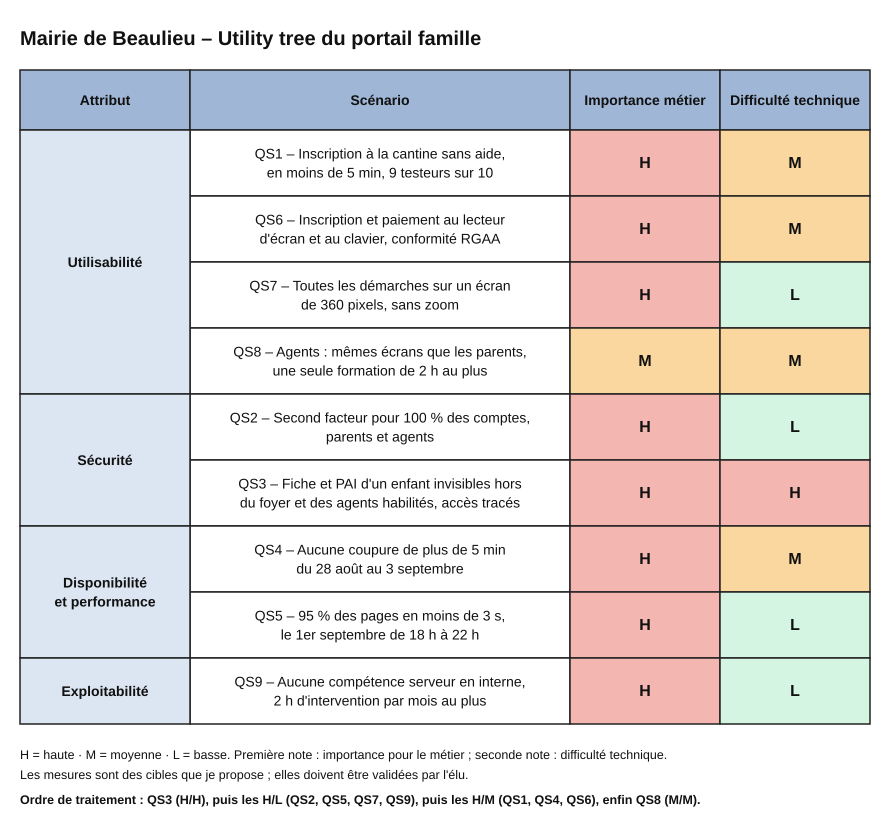

# Partie B — Mises en situation

## Usage de l'IA

J'ai utilisé l'assistant Claude (Anthropic), via l'outil Claude Code, pour extraire le texte brut du dossier de la mairie de Beaulieu afin de ne perdre aucun chiffre, puis pour proposer une première liste d'exigences de qualité tirées des notes de l'élu. J'ai vérifié que chaque exigence s'appuie sur une phrase réellement prononcée par l'élu, et j'ai marqué d'un **🤔** tous les seuils chiffrés qui ne figurent pas dans le dossier. Le choix des exigences retenues et les seuils proposés relèvent de mon propre jugement.

## Situation 3 — Mairie de Beaulieu (portail famille)

### Ce que j'ai compris

* La mairie de Beaulieu (**48 000 habitants, 11 écoles**) veut un « portail famille » qui regroupe l'inscription à la cantine, à la garderie et au centre de loisirs, le paiement en ligne et une messagerie avec les écoles. J'interviens comme architecte de l'entreprise prestataire qui a remporté le marché.
* Le portail s'adresse à **9 200 enfants, soit environ 6 500 familles**. Or les inscriptions sont très concentrées : **80 % ont eu lieu entre le 28 août et le 3 septembre, dont la moitié le 1er septembre entre 18 h et 22 h**. L'an dernier, le site de la ville est tombé pendant cette période, et l'élu a reçu **300 mails de parents en colère**.
* L'élu veut un portail à la fois très simple (« que ma grand-mère puisse l'utiliser »), très sécurisé (double authentification, « tout chiffré »), accessible aux personnes handicapées, utilisable entièrement depuis un téléphone, avec les mêmes écrans pour les agents de la mairie.
* Les moyens sont limités : un **budget voté de 140 000 €**, une **livraison en juin alors que nous sommes en novembre**, et une **équipe informatique de deux personnes** occupées surtout par les PC des écoles.
* Plusieurs éléments sont imposés de l'extérieur : un repas coûte **entre 0,80 € et 6,20 € selon le quotient familial**, recalculé chaque année avec l'avis d'imposition ; certains enfants ont un **PAI** que la cantine doit connaître ; le logiciel de pointage des écoles ne fournit qu'un **export CSV quotidien** ; enfin, le Trésor public impose le prestataire de paiement **PayFiP**, avec son propre délai d'intégration.
* Chaque demande de l'élu est donc légitime prise séparément, mais l'ensemble est impossible en juin avec 140 000 €. Mon travail consiste par conséquent à montrer ce que chaque exigence coûte aux autres, puis à proposer un ordre.

---

### Ce qui manque : hypothèses et informations manquantes

Le dossier laisse plusieurs points flous. Pour chacun, je cite l'extrait concerné, je pose une hypothèse et j'indique ce qui changerait si elle se révélait fausse. Dans tout le document, le symbole 🤔 signale une information incertaine : elle ne figure pas dans le dossier et reste à valider avec la mairie.


| Information manquante (extrait du dossier) | Hypothèse retenue | Ce qui change si elle est fausse |
|---|---|---|
| « 80 % des inscriptions […] **dont la moitié** le 1er septembre entre 18 h et 22 h » | Une inscription correspond à une famille, et « la moitié » porte sur les 80 % : on compte donc **2 600 familles en 4 heures** (livrable 5). | Avec 3 250 familles, le pic passe d'environ 120 à 150 requêtes par seconde, ce qui ne change pas la conclusion du livrable 5. |
| « Le budget a été voté : **140 000 €** » : le fonctionnement est-il inclus ? | Les 140 000 € couvrent uniquement la **réalisation** (V1 et V2). L'hébergement, les SMS, la maintenance et l'astreinte de la rentrée sont payés à part, chaque année. | Si le budget doit aussi couvrir le fonctionnement de la première année, il faut repousser une partie de la V2. |
| « **Livraison en juin** » : à quelle date exactement ? | Le portail est ouvert aux familles **à la mi-juin 2027**, afin qu'elles créent leur compte pendant l'été (compromis C3). | Une ouverture fin juin raccourcit la campagne de création des comptes, et le soir du 1er septembre déclenche alors davantage de SMS. |
| « Entre 0,80 € et 6,20 € par repas **selon le quotient familial** » : combien de tranches ? | La grille se compose de **tranches de quotient**, et les agents saisissent eux-mêmes chaque année les tranches et leurs prix. | Si le tarif suit une formule continue (un pourcentage du quotient, par exemple), seul le calcul du tarif change ; le reste du portail n'est pas touché (décision D1). |
| PayFiP, avec « **son propre délai d'intégration** » | Le délai d'adhésion et d'intégration est de **quelques mois 🤔**. On lance donc la démarche dès décembre, et le paiement en ligne arrive en septembre, avant la première facture (livrable 7). | Si PayFiP est prêt plus tôt, le paiement peut basculer en V1 ; s'il l'est plus tard, les familles paient au guichet pendant un ou deux mois. |
| Logiciel de pointage : « un **export CSV quotidien** et rien d'autre » | Le fichier contient, pour chaque enfant et chaque jour, sa présence à la cantine, avec un identifiant d'enfant stable. | Si l'identifiant n'est pas stable, il faut un rapprochement manuel par les agents. Si le fichier ne couvre pas la garderie, il faut un écran de pointage pour les animateurs (règle R14). |
| « Des enfants avec un **PAI** […] que la cantine doit connaître » | Le PAI est un document signé en dehors du portail. Le portail enregistre son existence, les consignes utiles à la cantine et une copie du document. | Si la mairie doit stocker l'intégralité des dossiers médicaux, la certification d'hébergeur de données de santé devient certaine (contrainte K6). |
| « **Messagerie** avec les écoles » : qui répond côté école ? | Les directeurs d'école dépendent de l'Éducation nationale et non de la mairie **🤔** : la mairie ne peut donc pas leur imposer un outil. La messagerie est reportée en V3. | Si les écoles s'engagent à l'utiliser, la messagerie peut être avancée en V2. |
| « Centre de loisirs » : le dossier n'en dit rien de plus | Il fonctionne le mercredi et pendant les vacances, avec le même quotient familial que la cantine. | S'il a ses propres règles (places limitées, priorités), il faut ajouter des règles métier en V2. |
| « Il faut que ça tienne le **1er septembre** » | La rentrée a lieu le lendemain du pic ou dans les jours qui suivent **🤔**. | Si la rentrée a lieu plus tôt, la liste des inscrits doit être produite avant le pic, et non après. |


---

### Livrable 1 — Exigences de qualité

L'élu n'a formulé aucune exigence de qualité en tant que telle : il a exprimé des souhaits, des souvenirs et des contraintes. Chaque scénario ci-dessous part donc d'une phrase de ses notes, citée entre guillemets, puis la reformule en scénario mesurable (qui, quoi, quand, mesure). Les seuils marqués **🤔** sont des **cibles que je propose** et que l'élu doit valider, car le dossier ne les fournit pas.

Les cinq premières exigences correspondent à ce que l'élu demande explicitement.

| # | Attribut et phrase de l'élu | Qui | Quoi | Quand | Mesure |
|---|---|---|---|---|---|
| QS1 | **Utilisabilité** : « le portail le plus simple de France, que ma grand-mère puisse l'utiliser » | Un parent qui n'a jamais utilisé le portail | inscrit son enfant à la cantine, de la connexion jusqu'à la confirmation | lors d'un test avec des parents, avant la mise en ligne | Au moins 9 testeurs sur 10 y parviennent seuls, en moins de 5 minutes **🤔**. |
| QS2 | **Sécurité (authentification)** : « double authentification » | Un parent ou un agent de la mairie | se connecte au portail | à chaque nouvelle connexion, ou après 30 minutes d'inactivité **🤔** | Tous les comptes passent par un second facteur (code reçu par SMS ou application). Aucun accès n'est possible avec le seul mot de passe. |
| QS3 | **Sécurité (confidentialité)** : « tout chiffré, on parle d'enfants » | Une personne extérieure, ou un parent d'un autre foyer | tente de consulter la fiche d'un enfant, notamment son PAI (projet d'accueil individualisé, qui contient des données de santé) | à tout moment | Toutes les tentatives sont refusées, sauf pour le foyer de l'enfant et les agents habilités. Les données sont chiffrées pendant leur transfert et dans la base, et chaque consultation d'un PAI est enregistrée dans un journal. |
| QS4 | **Disponibilité** : « l'an dernier, le site de la ville est tombé pendant les inscriptions, j'ai eu 300 mails de parents en colère » | Les familles qui s'inscrivent | utilisent le portail | du 28 août au 3 septembre, période qui concentre 80 % des inscriptions | Le portail ne subit aucune interruption de plus de 5 minutes sur la période **🤔**. |
| QS5 | **Performance au pic** : « il faut que ça tienne le 1er septembre » | Un parent qui s'inscrit | valide une inscription | le 1er septembre entre 18 h et 22 h, créneau qui concentre la moitié des inscriptions de la période | Au moins 95 % des pages s'affichent en moins de 3 secondes **🤔**. Le nombre de requêtes par seconde correspondant est calculé au livrable 5. |

Les quatre exigences suivantes sont plus cachées, car l'élu les présente comme une obligation légale, un confort ou une simple description de son équipe.

| # | Attribut et phrase de l'élu | Qui | Quoi | Quand | Mesure |
|---|---|---|---|---|---|
| QS6 | **Accessibilité** : « accessible aux personnes handicapées, c'est la loi » | Un parent malvoyant équipé d'un lecteur d'écran, ou un parent qui navigue uniquement au clavier | réalise une inscription et un paiement complets | lors d'un audit avant la mise en ligne | Le portail est conforme au RGAA (référentiel général d'amélioration de l'accessibilité, qui traduit l'obligation légale pour les collectivités) **🤔**, et tout le parcours se fait sans souris. |
| QS7 | **Adaptation au mobile** : « que les parents puissent tout faire depuis leur téléphone » | Un parent sur smartphone | réalise n'importe quelle démarche : inscription, paiement, messagerie avec l'école | au quotidien | Toutes les démarches sont réalisables sur un écran de 360 pixels de large, sans zoom et sans basculer vers une version pour ordinateur. |
| QS8 | **Facilité d'apprentissage** : « que les agents en mairie aient exactement les mêmes écrans, pour ne pas les former deux fois » | Un agent d'accueil de la mairie | réalise une inscription pour le compte d'un parent venu au guichet | après la formation initiale | Une seule formation de 2 heures au plus **🤔** suffit, car l'agent utilise les mêmes écrans que les parents, enrichis de quelques fonctions propres aux agents. |
| QS9 | **Exploitabilité** : « mon équipe informatique, c'est deux personnes, elles s'occupent surtout des PC des écoles » | L'équipe informatique de la mairie | assure le fonctionnement courant du portail (mises à jour, sauvegardes, incidents) | en exploitation courante, toute l'année | Le portail ne demande aucune compétence d'administration de serveurs en interne et pas plus de 2 heures d'intervention par mois **🤔**. |

Trois remarques éclairent ces choix :

* **QS4 et QS5 restent distinctes**, car un site peut rester en ligne tout en étant trop lent pour être utilisable. La première se mesure en durée d'interruption, la seconde en temps de réponse.
* **QS9 est l'exigence la plus cachée.** L'élu décrit son équipe comme un simple fait, mais ce fait impose un portail que deux personnes non spécialistes peuvent faire vivre. Par conséquent, elle oriente dès maintenant vers une solution hébergée et maintenue par un prestataire ; elle sera reprise comme contrainte au livrable 3.
* **Le budget de 140 000 € et la livraison en juin ne figurent pas ici**, car ce ne sont pas des qualités du portail mais des contraintes. Ils sont traités au livrable 3.

---

### Livrable 2 — Contradictions et compromis

Prise séparément, chaque exigence du livrable 1 est légitime ; prises ensemble, plusieurs se tirent dessus. Pour chaque paire en tension, j'explique d'où vient le conflit, j'écris le compromis sous la forme « on gagne X, on perd Y », puis je formule ma proposition.

Le premier groupe de contradictions oppose la sécurité exigée par l'élu à la simplicité et à la tenue du pic.

| # | Exigences en tension | Pourquoi elles se tirent dessus | Compromis | Ma proposition |
|---|---|---|---|---|
| C1 | QS1 simplicité et QS2 double authentification | La double authentification ajoute une étape à chaque connexion. Or la « grand-mère » de l'élu n'a pas forcément de smartphone, ni l'habitude de recopier un code. | Si l'on exige le second facteur à chaque connexion, on gagne en sécurité, mais on perd en simplicité, avec un risque d'abandons et d'appels au guichet. | Le second facteur est envoyé par SMS, car un téléphone simple suffit pour le recevoir. L'appareil habituel du parent est ensuite reconnu pendant 90 jours **🤔**. En revanche, le second facteur est toujours redemandé pour les actions sensibles, comme modifier un PAI ou le moyen de paiement enregistré, si le portail en conserve un. |
| C2 | QS1 simplicité et QS3 confidentialité | Avant d'ouvrir un compte, il faut vérifier que la personne est bien responsable de l'enfant ; sinon, n'importe qui pourrait inscrire un enfant ou lire son PAI. Or cette vérification alourdit la première inscription. | Avec une vérification sérieuse, on gagne la protection des enfants, mais on perd la simplicité lors de la première connexion. | La vérification n'a lieu qu'une seule fois, à la création du compte : la mairie envoie un code familial par courrier **🤔**, ou bien la famille se présente au guichet. Une fois le compte créé, le parcours redevient simple. |
| C3 | QS2 double authentification et QS4/QS5 tenue du pic | Le 1er septembre au soir, des milliers de parents se connectent en même temps et attendent chacun un SMS. Si le prestataire d'envoi de SMS ralentit, plus personne ne peut se connecter, alors que le portail lui-même fonctionne. | En gardant la double authentification, on gagne en sécurité, mais la tenue du pic dépend désormais d'un prestataire extérieur que nous ne maîtrisons pas. | Les parents créent leur compte et font reconnaître leur appareil dès l'ouverture du portail en juin, puis reçoivent une relance pendant l'été. Ainsi, le soir du pic, la plupart des appareils sont déjà reconnus et ne déclenchent aucun SMS. |

Le second groupe concerne les agents de la mairie et l'équipe informatique, dont les besoins diffèrent de ceux des parents.

| # | Exigences en tension | Pourquoi elles se tirent dessus | Compromis | Ma proposition |
|---|---|---|---|---|
| C4 | QS8 mêmes écrans et QS3 confidentialité | Un parent ne voit que son propre foyer, tandis qu'un agent doit pouvoir rechercher n'importe quelle famille et consulter les PAI pour la cantine. Avec des écrans strictement identiques, on montrerait aux parents des fonctions qui ne les concernent pas, ou l'on donnerait trop de droits aux agents. | Avec des écrans identiques, on gagne une formation unique, mais on perd le cloisonnement des données entre foyers. | L'agent utilise les mêmes écrans que le parent, en mode « agir pour le compte de la famille X ». Ses droits dépendent de son rôle : seuls les agents habilités voient les PAI, et chaque consultation est enregistrée dans un journal. |
| C5 | QS8 mêmes écrans et QS7 mobile | Des écrans conçus pour un téléphone de 360 pixels de large sont peu efficaces au guichet, où l'agent manipule des listes, des recherches et des exports. | Avec des écrans partagés, on gagne une seule formation, mais on perd en productivité pour les agents. | Les parcours des parents sont conçus d'abord pour le téléphone, et les agents les utilisent tels quels. En revanche, les écrans propres aux agents (listes, export des présences, import du fichier CSV des écoles) sont conçus pour un ordinateur. Par conséquent, les agents suivent une seule formation, complétée d'un court module sur leurs écrans spécifiques. |
| C6 | QS4/QS5 tenue du pic et QS9 équipe de deux personnes | Tenir le pic suppose d'ajuster les serveurs à la charge, de surveiller le portail et d'avoir quelqu'un mobilisable le 1er septembre au soir. Or l'équipe informatique de la mairie, qui compte deux personnes occupées par les PC des écoles, ne peut assurer aucune de ces tâches. | Avec un hébergement géré et une astreinte de l'entreprise prestataire, on gagne la tenue du pic, mais on perd en autonomie, car la mairie dépend du prestataire, et on ajoute un coût annuel. | Le portail est hébergé chez un prestataire qui ajuste automatiquement les serveurs à la charge. De plus, l'entreprise prestataire assure une astreinte du 28 août au 3 septembre, chiffrée à part. L'équipe de la mairie n'intervient donc jamais sur les serveurs. |

Deux remarques complètent ce tableau :

* **Simplicité (QS1), accessibilité (QS6) et usage sur mobile (QS7) ne se contredisent pas** : un parcours court, lisible et utilisable au doigt sert à la fois la grand-mère, le parent handicapé et le parent sur son téléphone. Leur véritable conflit porte sur le coût des tests avec des parents et de l'audit d'accessibilité face au délai de juin ; ce point est donc traité avec les contraintes au livrable 3.
* **La page de paiement PayFiP échappe à notre contrôle**, car elle est imposée par le Trésor public et fournie par lui. Son accessibilité (QS6) et son affichage sur téléphone (QS7) ne dépendent donc pas de nous **🤔** ; ce point sera repris au livrable 3.

---

### Livrable 3 — Contraintes non négociables

Contrairement aux exigences de qualité, une contrainte ne se discute pas : elle s'impose au projet, et l'architecture doit faire avec. Pour chacune, je cite sa source, puis j'indique ce qu'elle interdit d'office.

Les trois premières contraintes fixent les moyens du projet : l'argent, le temps et les personnes.

| # | Contrainte (source) | Famille | Ce qu'elle interdit |
|---|---|---|---|
| K1 | **Budget de 140 000 €**, « voté » (notes de l'élu) | Budget | Elle interdit de développer nous-mêmes des briques génériques qui s'achètent, comme l'authentification, l'envoi de SMS ou l'hébergement. Elle interdit aussi de livrer en V1 les cinq services complets (cantine, garderie, centre de loisirs, paiement et messagerie), ainsi que de développer une application native à publier sur les magasins d'applications. |
| K2 | **Livraison en juin** : « livraison en juin, on est en novembre » (notes de l'élu), soit environ 7 mois (déduit) | Délai | Elle interdit d'utiliser des technologies que l'équipe de l'entreprise prestataire ne maîtrise pas déjà. Elle interdit aussi de repousser à la fin du projet les tests avec des parents et l'audit d'accessibilité : ces activités prennent du temps, et elles doivent donc être planifiées dès le départ (voir la remarque du livrable 2). |
| K3 | **Équipe informatique de deux personnes**, qui « s'occupent surtout des PC des écoles » (notes de l'élu) | Équipe | Elle interdit un serveur installé en mairie, une architecture lourde à exploiter et tout composant qui demande une administration quotidienne. Elle impose donc un hébergement géré par un prestataire et un contrat de maintenance (voir QS9 et le compromis C6). |

Les quatre contraintes suivantes viennent de l'extérieur du projet : le Trésor public, la loi et le logiciel d'un autre éditeur.

| # | Contrainte (source) | Famille | Ce qu'elle interdit |
|---|---|---|---|
| K4 | **PayFiP**, prestataire de paiement imposé par le Trésor public, avec « sa propre documentation et son propre délai d'intégration » (dossier) | Organisation publique | Elle interdit tout autre prestataire de paiement, ainsi que le stockage des numéros de carte par le portail. Elle interdit aussi d'attendre la fin du projet pour lancer l'adhésion à PayFiP, car son délai d'intégration n'est pas connu **🤔**. Enfin, elle nous prive de tout contrôle sur la page de paiement, donc sur son accessibilité (QS6) et son affichage sur téléphone (QS7). |
| K5 | **Accessibilité obligatoire** : « c'est la loi » (notes de l'élu). Le référentiel applicable aux collectivités est le RGAA (déduit). | Loi | Elle interdit les écrans utilisables uniquement à la souris, les captchas en image et un second facteur purement visuel, comme un QR code sans autre option. |
| K6 | **RGPD**, appliqué à des données de mineurs et à des PAI, qui sont des données de santé (dossier) | Loi | Elle interdit l'hébergement hors de l'Union européenne sans garanties, la conservation des données sans durée limite et l'accès aux PAI sans habilitation ni traçabilité. De plus, si la mairie confie ces données à un hébergeur, celui-ci doit probablement être certifié HDS (hébergeur de données de santé) **🤔**, ce qui restreint le choix de l'hébergeur et en augmente le coût. |
| K7 | **Logiciel de pointage des écoles**, fourni par un autre éditeur, avec « un export CSV quotidien et rien d'autre » (dossier) | Technique | Elle interdit toute synchronisation des présences en temps réel et toute interface de programmation (API) avec ce logiciel. Elle impose donc l'import d'un fichier par jour, si bien que les présences arrivent avec un jour de retard. |

Deux remarques complètent ce tableau :

* **K6 est la contrainte la plus lourde que l'élu n'a pas vue.** En effet, si la certification HDS s'applique, elle pèse à la fois sur le budget (K1) et sur le choix de l'hébergeur (K3). Je la marque **🤔**, car le délégué à la protection des données de la mairie doit confirmer qu'elle s'applique bien au stockage des PAI pour la cantine.
* **Le recalcul annuel du quotient familial n'est pas une contrainte technique, mais une règle métier.** Il est donc traité au livrable 6.

---

### Livrable 4 — Utility tree

L'utility tree reprend les neuf scénarios du livrable 1 et les range par attribut de qualité. Chaque scénario porte deux notes sur l'échelle H (haute), M (moyenne) et L (basse) : la première mesure son importance pour le métier, la seconde sa difficulté technique.



#### Pourquoi ces notes H

Huit scénarios sur neuf sont notés H en importance, ce qui est cohérent avec la situation : l'élu a raison sur chaque point pris séparément. Par conséquent, l'arbre départage surtout les scénarios par leur difficulté technique. Chaque note H est justifiée ci-dessous en une phrase.

| # | Importance métier | Difficulté technique |
|---|---|---|
| QS1 | **H** : c'est la première demande de l'élu, et un portail trop compliqué renverrait les parents au guichet. | M : la difficulté n'est pas technique, mais elle impose des maquettes et des tests avec de vrais parents. |
| QS2 | **H** : l'élu l'exige explicitement, car le portail contient des données d'enfants. | L : il s'agit d'une brique générique qui s'achète au lieu d'être développée. |
| QS3 | **H** : une fuite de PAI, c'est-à-dire de données de santé d'enfants, engagerait la responsabilité de la mairie. | **H** : le cloisonnement par foyer, les rôles des agents et le journal des consultations doivent être conçus dès le modèle de données, car on ne peut pas les ajouter après coup. |
| QS4 | **H** : la panne de l'an dernier a valu 300 mails de parents en colère à l'élu, ce qui en fait un risque politique. | M : un hébergement géré règle l'essentiel, mais l'envoi des SMS et PayFiP restent deux dépendances extérieures pendant la période. |
| QS5 | **H** : un portail en ligne mais trop lent provoque les mêmes plaintes qu'un portail en panne. | L : le volume au pic reste modeste, puisqu'il représente environ 650 familles par heure (voir le livrable 5). |
| QS6 | **H** : l'accessibilité est une obligation légale pour une collectivité, comme le rappelle l'élu. | M : elle doit être intégrée dès la conception des écrans, puis vérifiée par un audit avant la mise en ligne. |
| QS7 | **H** : la plupart des parents feront leurs démarches depuis leur téléphone. | L : un site web qui s'adapte à la taille de l'écran suffit, sans application à publier. |
| QS9 | **H** : sans exploitation assurée, le portail se dégrade dès la fin de la livraison, car personne en interne ne peut l'entretenir. | L : il suffit d'acheter un hébergement géré et un contrat de maintenance. |

QS8 n'apparaît pas dans ce tableau, car il ne porte aucune note H : il est noté M/M. En effet, des écrans communs aux parents et aux agents permettent d'économiser une formation, mais leur absence ne bloquerait pas le portail.

#### Par où commencer : QS3, puis les scénarios H/L

* **QS3 vient en premier, car c'est le seul scénario H/H et il structure le modèle de données.** Le cloisonnement par foyer et les rôles des agents (voir le compromis C4) doivent être décidés avant d'écrire la première ligne de code.
* **Les scénarios H/L viennent ensuite (QS2, QS5, QS7, QS9)**, car ils sont importants mais peu coûteux. De plus, ils se règlent en grande partie par des achats : un service d'authentification, un hébergement géré et un contrat de maintenance.
* **Les scénarios H/M suivent (QS1, QS4, QS6).** Ils demandent du temps plutôt que de la technique, sous forme de tests avec des parents, d'un audit d'accessibilité et d'une préparation du pic ; ils doivent donc être planifiés tôt pour être prêts en juin.
* **QS8 passe en dernier**, car il est noté M/M.

---

### Livrable 5 — Calcul du 1er septembre

**Données du dossier** : la mairie compte 6 500 familles et 9 200 enfants, soit environ 1,4 enfant par famille. De plus, 80 % des inscriptions ont eu lieu entre le 28 août et le 3 septembre, « dont la moitié le 1er septembre entre 18 h et 22 h ». En comptant une inscription par famille (voir les hypothèses ci-dessous), on obtient :

```
6 500 familles × 80 % (du 28 août au 3 septembre)        = 5 200 familles
5 200 familles × 50 % (le 1er septembre, de 18 h à 22 h)  = 2 600 familles en 4 heures
```

#### Hypothèses que je pose, car le dossier ne les fournit pas

| Hypothèse | Valeur retenue |
|---|---|
| Le dossier parle de « 80 % des inscriptions » sans préciser s'il compte par famille, par enfant ou par service. Je suppose qu'une inscription correspond à une famille qui inscrit tous ses enfants en une seule visite **🤔**. Si l'on comptait par enfant, on obtiendrait 9 200 × 80 % × 50 % = 3 680 inscriptions ; le résultat changerait peu, car les 1,4 enfant par famille sont déjà comptés dans les pages consultées. | 1 inscription = 1 famille |
| L'expression « la moitié » porte sur les 80 % d'inscriptions de la période. Si elle portait sur l'ensemble des inscriptions, on compterait 3 250 familles **🤔**. | 2 600 familles |
| Une famille consulte environ 15 pages : la connexion et le second facteur (4 pages), le tableau de bord (1), le choix des services pour 1,4 enfant (4), le dépôt de l'avis d'imposition (1), le récapitulatif et la validation (2), puis quelques vérifications (3). | 15 pages |
| Chaque page déclenche environ 10 requêtes HTTP vers le serveur (données et fichiers non mis en cache). | 10 requêtes |
| Certains parents reviennent vérifier leur inscription, rafraîchissent la page ou se trompent, ce qui augmente le nombre de requêtes. | × 1,5 |
| Les connexions ne sont pas réparties uniformément sur les 4 heures : elles se concentrent vers 20 h - 21 h, après le dîner. | × 3 |

#### Calcul

```
Requêtes par famille = 15 pages × 10 requêtes × 1,5   = 225
Requêtes sur 4 h     = 2 600 × 225                     ≈ 585 000
Moyenne du créneau   = 585 000 / 14 400 s              ≈ 40 req/s
Pic (20 h - 21 h)    = 40 × 3                          ≈ 120 req/s
Avec 3 250 familles  →                                 ≈ 150 req/s
```

**Conclusion : la puissance de calcul n'est pas le problème.** En effet, comme le rappelle le cours, un serveur bien réglé tient environ 130 requêtes par seconde ; quelques serveurs hébergés chez un prestataire couvrent donc largement le pic, même dans l'hypothèse haute. Par conséquent, la panne de l'an dernier s'explique probablement par un site de la ville mal hébergé plutôt que par un volume énorme. Les vrais points durs se situent ailleurs :

* **le site de la ville** : s'il porte le lien vers le portail et qu'il tombe, les parents ne trouvent plus le portail. Le portail doit donc avoir son propre hébergement et sa propre adresse ;
* **le dépôt des avis d'imposition** : 2 600 fichiers d'environ 2 Mo chacun **🤔** représentent environ 5 Go reçus en 4 heures, ce qui pèse bien plus que les pages elles-mêmes ;
* **les SMS de double authentification**, qui dépendent d'un prestataire extérieur (voir le compromis C3).

#### Ce qui doit tenir ce soir-là, et ce qui peut être dégradé ou fermé

Le principe est simple : ce soir-là, seul ce qui sert l'inscription et la rentrée du lendemain doit fonctionner à coup sûr ; tout le reste peut attendre quelques jours.

| Fonction | Statut le 1er septembre, de 18 h à 22 h | Pourquoi |
|---|---|---|
| Connexion et second facteur | **Doit tenir** | Sans connexion, aucune autre démarche n'est possible. |
| Inscription à la cantine et à la garderie | **Doit tenir** | C'est la raison même du pic, et ces services fonctionnent dès la rentrée **🤔**. |
| Saisie et transmission des PAI | **Doit tenir** | La cantine doit connaître les allergies et les traitements dès le premier repas. |
| Liste des inscrits pour la cantine du lendemain | **Doit tenir**, mais elle est produite après 22 h | Les cantines préparent les repas du lendemain à partir de cette liste. |
| Dépôt de l'avis d'imposition | **Dégradé** : facultatif ce soir-là, et possible jusqu'au 30 septembre **🤔** | Ce report supprime le plus gros volume de fichiers du pic. En attendant, on applique le quotient familial de l'année précédente **🤔**. |
| Inscription au centre de loisirs | **Dégradée** : ouverte, mais non prioritaire | Les mercredis du centre de loisirs commencent après la rentrée **🤔**, donc rien ne presse. |
| Paiement en ligne (PayFiP) | **Fermé** | Si la facture est mensuelle **🤔**, rien n'est à payer le jour de l'inscription ; de plus, on retire ainsi une dépendance extérieure du pic. |
| Messagerie avec les écoles | **Fermée**, ou en lecture seule | Elle ne présente aucune urgence ce soir-là. |
| Exports et listes destinés aux agents | **Reportés** après 22 h | Ce sont des requêtes lourdes qui ne servent à aucun parent pendant le pic. |

Enfin, si la charge dépasse malgré tout la capacité prévue, une **file d'attente virtuelle** fait patienter les parents quelques minutes au lieu de laisser le site tomber. On gagne ainsi un portail qui reste en ligne, mais on perd un peu de confort pour les parents qui attendent.

---

### Livrable 6 — Règles métier de la cantine et de la garderie

Chaque ligne énonce une seule règle, et sa source distingue les faits du dossier de mes déductions :

* **Dossier** : la règle est écrite dans les notes de l'élu ou dans « ce que vous savez par ailleurs » ;
* **Déduite** : la règle se lit dans le dossier, mais n'y est pas écrite explicitement ;
* **🤔** : la règle est une hypothèse que je pose, faute d'information, et elle doit être validée par la mairie.

Les premières règles portent sur le tarif et le quotient familial.

| # | Règle | Source |
|---|---|---|
| R1 | Le prix d'un repas à la cantine dépend du quotient familial du foyer, entre 0,80 € et 6,20 €. | Dossier |
| R2 | Le quotient familial est recalculé chaque année à partir de l'avis d'imposition du foyer. | Dossier |
| R3 | Le même quotient familial s'applique à tous les enfants du foyer. | Déduite |
| R4 | Le tarif de la garderie dépend lui aussi du quotient familial. | 🤔 |
| R5 | La garderie est facturée à la séance, que ce soit le matin ou le soir. | 🤔 |
| R6 | Tant que le nouvel avis d'imposition n'est pas fourni, et jusqu'au 30 septembre au plus tard, la mairie applique le quotient de l'année précédente. | 🤔 (hypothèse du livrable 5) |
| R7 | Si la famille n'a fourni aucun avis après le 30 septembre, elle paie le tarif maximal. | 🤔 |
| R8 | Un nouveau quotient s'applique à partir du mois où l'avis est reçu, sans effet rétroactif. | 🤔 |

Les règles suivantes concernent les PAI, c'est-à-dire la sécurité des enfants.

| # | Règle | Source |
|---|---|---|
| R9 | La cantine doit connaître le PAI d'un enfant avant de lui servir un repas. | Dossier |
| R10 | Un enfant dont le PAI est déclaré mais pas encore transmis ne mange pas à la cantine. Cette règle relève de la décision de l'élu (livrable 8). | 🤔 |
| R11 | Le PAI est aussi transmis à la garderie lorsque l'enfant y prend un goûter ou un traitement. | 🤔 |
| R12 | Seuls les agents habilités consultent un PAI, et chaque consultation est enregistrée. | Déduite (QS3 et K6) |

Les dernières règles portent sur les présences, l'annulation et la facturation.

| # | Règle | Source |
|---|---|---|
| R13 | Les présences à la cantine arrivent chaque jour par l'export CSV du logiciel de pointage des écoles. | Dossier |
| R14 | Les présences à la garderie sont aussi relevées par ce logiciel de pointage. | 🤔 |
| R15 | La mairie facture les repas réservés, et non les repas réellement pris. | 🤔 |
| R16 | Un parent peut annuler un repas ou une séance de garderie jusqu'à la veille à 10 h. | 🤔 |
| R17 | Un repas ou une séance qui n'a pas été annulé à temps est facturé, sauf en cas d'absence pour maladie justifiée par un certificat. | 🤔 |
| R18 | La facture est mensuelle et regroupe la cantine et la garderie de tous les enfants du foyer. | 🤔 (hypothèse du livrable 5) |
| R19 | La facture se paie en ligne obligatoirement par PayFiP. | Dossier |

Deux de ces règles incertaines pèsent particulièrement sur l'architecture :

* **R15 décide du rôle du fichier CSV des présences.** Si la mairie facture les repas réellement pris, une erreur d'import produit des factures fausses ; l'import devient donc critique et doit être contrôlé. À l'inverse, si elle facture les repas réservés, ce fichier sert seulement à informer les parents.
* **R14 décide s'il faut un écran supplémentaire.** Si le logiciel des écoles ne relève pas les présences à la garderie, il faut un écran de pointage pour les animateurs, ce qui n'est pas prévu dans le périmètre actuel.

---

### Livrable 7 — V1 juin / V2 / V3

Le principe qui guide le découpage est le suivant : **en juin, il faut livrer tout ce qui sert le soir du 1er septembre et le premier jour de cantine, et seulement cela.** En effet, la première facture n'est émise qu'à la fin septembre ; le paiement peut donc arriver en septembre, ce qui retire de la V1 le délai incertain de PayFiP (contrainte K4).

| Version | Échéance proposée | Périmètre |
|---|---|---|
| **V1** | Ouverture aux familles à la mi-juin 2027, puis test de charge en juillet et astreinte du 28 août au 3 septembre | Le compte famille, avec la vérification à la création (C2) et la double authentification achetée (C1). Le foyer, les enfants et leur école, ainsi que la déclaration des PAI. L'inscription à la cantine et à la garderie, l'annulation, le dépôt de l'avis d'imposition et le calcul du quotient. Le mode agent « pour le compte de la famille » (C4), l'import quotidien du CSV des présences et la liste des inscrits pour la cantine du lendemain. L'ensemble est accessible (RGAA), conçu d'abord pour le téléphone et hébergé chez un prestataire. |
| **V2** | Septembre et octobre 2027, avant la première facture et avant les vacances de la Toussaint | La facture mensuelle et le paiement en ligne par PayFiP. L'inscription au centre de loisirs, pour les mercredis et les vacances. Les écrans de suivi des agents (listes, relances des avis d'imposition manquants). |
| **V3** | 2028, avec un nouveau budget | La messagerie avec les écoles, à condition que les directeurs s'engagent à l'utiliser. Les notifications aux parents, et le pointage de la garderie si le logiciel des écoles ne le couvre pas (R14). |

Ce découpage permet de tenir le budget, à condition d'accepter des estimations que je devrai affiner pendant le cadrage : **environ 95 000 € pour la V1, environ 30 000 € pour la V2 et une réserve d'environ 15 000 €** pour les imprévus, notamment l'intégration de PayFiP **🤔**. La V3 n'entre donc pas dans les 140 000 €.

#### Portes ouvertes : décisions prises dès la V1 pour préparer la V2 et la V3

Ces décisions ne construisent pas les versions suivantes, mais elles évitent qu'elles imposent une refonte coûteuse.

| # | Décision prise en V1 | Coût en V1 | Ce qu'elle rend possible ensuite |
|---|---|---|---|
| D1 | Chaque **service** (cantine, garderie) est décrit par des paramètres : sa grille de tarifs par tranche de quotient, ses créneaux et son heure limite d'annulation. Le calcul du tarif est isolé derrière une interface unique (pattern **Strategy**). | Ce coût est faible, car il ne demande qu'un écran de paramétrage pour les agents. | Le **centre de loisirs** de la V2 devient un nouveau service paramétré, et non un nouveau développement. Si la mairie change de mode de tarification, seul le calcul change. |
| D2 | Les présences sont lues par une prise unique, la « source de présences », dont l'import CSV n'est qu'une version (pattern **Adapter**). | Ce coût est presque nul. | Si l'éditeur du logiciel de pointage propose un jour une API, ou s'il faut un pointage de la garderie par les animateurs (V3), seule la prise change. |
| D3 | La facture est calculée sans dépendre du moyen de paiement, qui est caché derrière sa propre prise (pattern **Adapter**). | Ce coût est faible. | PayFiP se branche en V2 sans toucher au calcul des factures. Un éventuel prélèvement automatique pourra s'ajouter de la même façon. |
| D4 | Chaque enfant est rattaché à son **école** dès la V1, et le portail gère des **rôles** (parent, agent, agent habilité aux PAI). | Ce coût est presque nul. | La **messagerie** de la V3 sait à quelle école adresser un message, et il suffit d'ajouter un rôle « école ». |
| D5 | Les faits importants (inscription enregistrée, repas annulé, PAI modifié) sont publiés sous forme d'**événements**, auxquels les autres modules s'abonnent (pattern **Observer**). | Ce coût est faible. | Les **notifications** de la V3 s'abonnent à ces événements sans modifier l'inscription ni la cantine. |

---

### Livrable 8 — Note à l'élu

> **Objet : portail famille — ce que vous aurez en juin, et la décision qui vous revient**
>
> Monsieur l'élu,
>
> **Ce que vous aurez en juin.** Les familles pourront créer leur compte, protégé par une double authentification, inscrire leurs enfants à la cantine et à la garderie, déclarer les PAI, déposer leur avis d'imposition et annuler un repas, tout cela depuis leur téléphone. Le portail sera accessible aux personnes handicapées, et vos agents utiliseront les mêmes écrans pour aider les familles au guichet. Il sera ouvert dès la mi-juin, afin que les familles créent leur compte pendant l'été plutôt que le soir du 1er septembre.
>
> **Le 1er septembre tiendra.** Le portail sera hébergé à part du site de la ville, testé en charge en juillet et surveillé par notre équipe du 28 août au 3 septembre. Ce soir-là, seules l'inscription et la transmission des PAI seront prioritaires, et le reste pourra attendre quelques jours.
>
> **Ce que vous n'aurez pas en juin.** Le paiement en ligne et le centre de loisirs arriveront en septembre et en octobre, avant la première facture et avant les vacances de la Toussaint. La messagerie avec les écoles est reportée à 2028, car elle suppose l'accord des directeurs d'école, qui ne dépendent pas de la mairie.
>
> **Ce que cela coûte.** Environ 95 000 € pour juin, 30 000 € pour l'automne et 15 000 € de réserve, soit les 140 000 € votés. Il faudra en revanche prévoir chaque année un budget de fonctionnement pour l'hébergement, les SMS, la maintenance et l'astreinte de la rentrée, que je chiffrerai pendant le cadrage. Votre équipe informatique n'aura pas à intervenir sur les serveurs.
>
> **La décision qui vous revient.** Un enfant dont la famille a déclaré un PAI, mais dont le document signé n'est pas encore transmis, peut-il manger à la cantine le jour de la rentrée ? Si vous répondez non, vous protégez l'enfant, mais une famille devra trouver une autre solution pour le midi. Si vous répondez oui, l'enfant mange, mais la cantine le sert sans consignes validées. Cette décision engage la responsabilité de la mairie envers les familles ; ce n'est donc pas à l'architecte de la prendre en l'écrivant dans le code. J'ai besoin de votre réponse avant la fin du cadrage, en décembre.

---

### Ce que je refuse de faire, et pourquoi

| Je refuse de… | Parce que… |
|---|---|
| promettre les cinq services pour juin, | 140 000 € et 7 mois ne suffisent pas à tout livrer correctement. Je livre donc en juin ce qui sert la rentrée, puis le reste dans l'ordre du livrable 7. |
| décider à la place de l'élu si un enfant dont le PAI n'est pas transmis peut manger à la cantine, | cette décision engage la responsabilité de la mairie envers les enfants et les familles. C'est un choix politique, et non technique (livrable 8). |
| héberger le portail sur un serveur de la mairie ou à côté du site de la ville, | l'équipe de deux personnes ne peut pas l'exploiter (K3), et le site de la ville est justement tombé l'an dernier. |
| développer nous-mêmes l'authentification ou le paiement, ou stocker des numéros de carte, | ces briques génériques s'achètent, et le Trésor public impose PayFiP (K4). Les développer coûterait cher et ajouterait des risques de sécurité. |
| donner à tous les agents l'accès aux PAI pour que leurs écrans soient exactement ceux des parents, | ce sont des données de santé d'enfants : seuls les agents habilités y ont accès, et chaque consultation est enregistrée (C4 et K6). |
| inventer la grille des tarifs, les heures limites d'annulation ou les règles de la garderie, | le dossier ne les donne pas. Je pose donc des hypothèses marquées 🤔, et la mairie saisit elle-même ses tarifs (décision D1). |
| ouvrir le portail pour la première fois à la fin août, sans test de charge, | le premier vrai test serait alors le soir du pic, c'est-à-dire exactement ce qui a provoqué les 300 mails de l'an dernier. |
