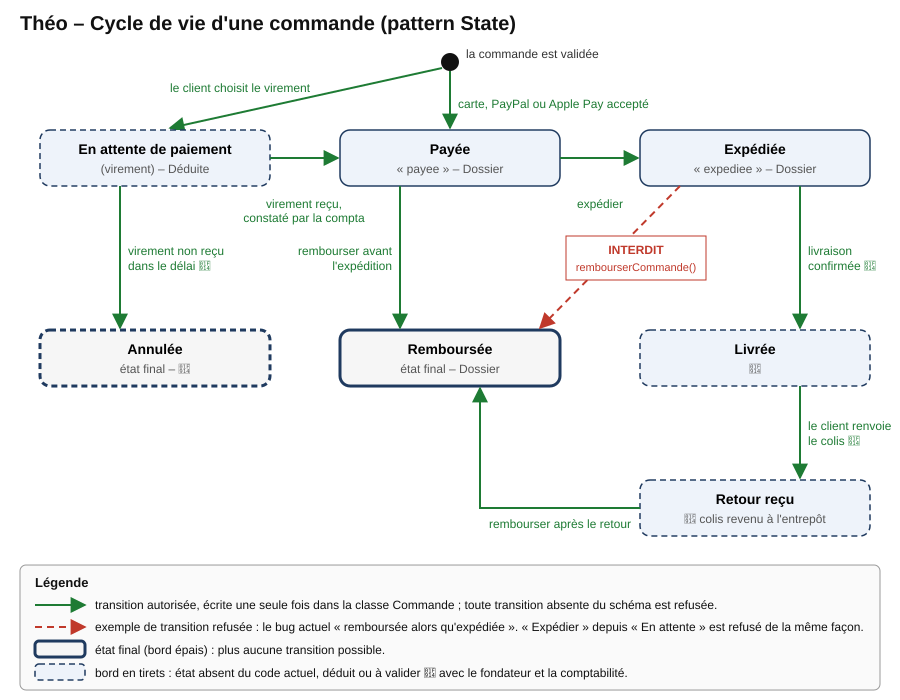
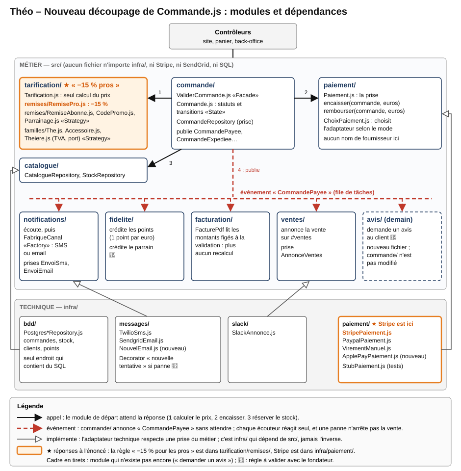

# Partie B — Mises en situation

## Usage de l'IA

J'ai utilisé l'assistant Claude (Anthropic), via l'outil Claude Code, pour extraire le texte brut du dossier Théo et de l'extrait de `Commande.js`, pour numéroter les lignes de cet extrait et pour proposer une première version des tableaux et des deux schémas (le cycle de vie et le découpage en modules). J'ai ensuite relu chaque ligne citée contre l'extrait du dossier ; cette relecture m'a notamment fait relever deux défauts que l'énoncé ne signale pas : la variable `fraisPort` est calculée mais n'apparaît dans aucun montant débité, et la variable `tva` est calculée mais n'est jamais utilisée. J'ai marqué d'un **🤔** tout ce que l'extrait ne permet pas de trancher. L'attribution des lignes à chaque « chef », le choix des patterns, l'ordre des travaux et l'avis au fondateur relèvent de mon propre jugement.

## Situation 4 — Théo (revue de code)

### Ce que j'ai compris

* Théo vend du thé en ligne : **12 000 commandes par mois**, soit environ **400 par jour**, avec une équipe de **3 développeurs**. Le fondateur veut une revue de code **avant d'embaucher un quatrième développeur**.
* Le fichier `Commande.js` « fait tout » en **900 lignes**. Sa fonction `validerCommande` calcule le prix, encaisse le paiement (Stripe, PayPal ou virement), enregistre la commande, décrémente le stock, prévient le client (Twilio ou SendGrid), annonce la vente sur Slack et crédite les points de fidélité.
* Le calcul du prix est **recopié à trois endroits** (`validerCommande`, `calculerPrixPanier`, `genererFacturePdf`), et les copies ont déjà divergé : la facture applique **20 % de TVA partout**, alors que la validation applique **5,5 % partout**, en oubliant que les accessoires sont à 20 %.
* Le cycle de vie n'est protégé nulle part : `expedierCommande()` expédie sans vérifier le paiement, et `rembourserCommande()` rembourse une commande **déjà expédiée**.
* Quatre évolutions arrivent **dans les 6 mois** : **Apple Pay**, une offre de **parrainage**, la vente de **théières** (TVA à 20 %, port différent) et un **fournisseur d'emails moins cher**. Avec 400 commandes par jour, la charge n'est pas le sujet ; le vrai problème est que chaque évolution rouvre la même fonction, qui encaisse l'argent des clients.

---

### Ce qui manque : hypothèses et informations manquantes

Le dossier ne montre que le cœur « simplifié » de 900 lignes. Pour chaque point flou, je cite l'extrait, je pose une hypothèse et j'indique ce qui changerait si elle se révélait fausse. Dans tout le document, le symbole 🤔 signale une information incertaine : elle ne figure pas dans le dossier et reste à valider avec le fondateur ou la comptabilité.

<div class="tableau-long">

| Information manquante (extrait du dossier) | Hypothèse retenue | Ce qui change si elle est fausse |
|---|---|---|
| `const tva = total * 0.055` : on ignore si les prix du catalogue sont **hors taxes ou toutes taxes comprises** | Les prix affichés aux particuliers sont **TTC**. La TVA contenue dans un prix se calcule donc par `total × 5,5 / 105,5`, et non par `total × 0,055` **🤔**. | Si les prix sont hors taxes, le montant débité (`total`) n'inclut aucune TVA : Théo encaisserait alors moins que ce qu'il doit à l'État, ce qui serait plus grave encore. |
| `if (total > 60) fraisPort = 0; else fraisPort = 4.9;` : `fraisPort` n'entre dans **aucun montant envoyé** à Stripe ou à PayPal | L'extrait est simplifié, et le port est ajouté ailleurs dans le fichier **🤔**. | Si ce n'est pas le cas, les frais de port (4,90 € par commande de moins de 60 €) ne sont jamais encaissés. Il faut alors le vérifier dans les relevés Stripe dès la première semaine. |
| Les remises client (`0.85`, `0.90`) puis les codes promo (`NOEL25`) s'appliquent **les uns après les autres** | Le cumul est voulu, et on le **conserve à l'identique** tant que le fondateur n'a pas tranché **🤔** : un pro qui utilise `NOEL25` paie aujourd'hui 0,85 × 0,75 = 63,75 % du prix. | Si le cumul n'est pas voulu, c'est une règle à changer dans un seul fichier après le découpage (livrable 6), et non un bug d'architecture. |
| Virement : `// on valide, le compta vérifiera`, puis la commande est enregistrée avec le statut `"payee"` | La comptabilité rapproche les virements à la main. La commande devrait donc rester **en attente de paiement** jusqu'à ce rapprochement (Déduite). | Si la comptabilité veut expédier avant réception du virement (clients pros de confiance, par exemple), on ajoute une transition autorisée pour ces clients 🤔. |
| `rembourserCommande()` sur une commande `"expediee"` est présenté comme un bug | Une commande expédiée n'est remboursée **qu'après le retour du colis** **🤔**, ce qui correspond au droit de rétractation de la vente à distance. | Si Théo rembourse sans retour (colis perdu, geste commercial), on ajoute une transition dédiée, accessible seulement au service client 🤔. |
| Les théières ont un « port différent », sans montant ni règle | La logistique fournira une grille de port propre aux théières (poids, fragilité) **🤔**. Le cas d'un panier qui mélange du thé et une théière reste à trancher **🤔**. | Le montant ne change pas l'architecture : il se loge dans le fichier de la famille « théière » (livrable 3). |
| L'offre « parrainage » n'est pas décrite | Le filleul reçoit une remise sur sa première commande, et le parrain reçoit des points de fidélité une fois cette commande payée **🤔**. | Si la récompense est un bon d'achat, seul l'écouteur du parrain change ; la structure reste la même. |
| Les **tests automatisés** ne sont jamais mentionnés | Il n'en existe aucun sur `Commande.js` **🤔**. | S'il en existe, les tests du livrable 7 complètent ceux qui existent au lieu de partir de zéro. |
| La technologie n'est pas nommée | Node.js (fichier `.js`, `async`/`await`) et PostgreSQL (paramètres `$1`, `$2` dans les requêtes) : c'est **Déduit** de l'extrait. | Le raisonnement ne dépend pas de la technologie ; seuls les noms de fichiers changeraient. |
| Les volumes par moyen de paiement et le pic de l'année ne sont pas donnés | La carte domine, et le pic se situe avant Noël (le code `NOEL25` existe) **🤔**. | Si PayPal domine, la migration vers les adaptateurs commence par PayPal plutôt que par Stripe. |

</div>

---

### Livrable 1 — Les « chefs » de `validerCommande` (le S de SOLID)

Pour citer les lignes sans ambiguïté, je numérote l'extrait du dossier à partir de la déclaration de la fonction.

```
 1 async function validerCommande(panier, client, modePaiement, codePromo) {
 2-10   boucle sur les lignes : prix × quantité ; pro × 0.85 ; abonné × 0.90 ;
        coffret ET abonné × 0.95 ; total += prix
11   if (codePromo === "NOEL25") total = total * 0.75;
12   if (codePromo === "BIENVENUE") total = total - 5;
13   if (total > 60) fraisPort = 0; else fraisPort = 4.9;
14   const tva = total * 0.055;   // accessoires à 20 % oubliés
15-24 paiement : carte → stripe.charges.create ; paypal → paypal.payment.create ;
      virement → « on valide, le compta vérifiera »
25-29 INSERT INTO commandes (..., "payee") ; UPDATE produits SET stock = stock - quantité
30-32 SMS par twilio OU email par sendgrid, selon client.preferences.canal
33   slack.post("#ventes", ...)
34   UPDATE clients SET points = points + Math.floor(total)
35   return cmd;
```

Le cours définit le S ainsi : « un fichier, un seul chef », c'est-à-dire une seule personne qui peut demander de le modifier. Or **sept chefs différents** peuvent demander une modification de cette seule fonction de 35 lignes. Le dossier en nomme trois (le fondateur, « le compta » et le canal `#ventes`) ; les quatre autres sont **déduits** du contenu des lignes et devront être confirmés par le fondateur.

| Chef | Lignes qui lui appartiennent | Exemple de demande qui rouvre la fonction | Source |
|---|---|---|---|
| **Le fondateur** (politique commerciale) | 6 à 8 : −15 % pour les pros, −10 % pour les abonnés, −5 % de plus sur les coffrets pour les abonnés | « Passez les pros à −20 % » ou « lancez le parrainage ». | Dossier (c'est lui qui commande la revue) |
| **Le marketing** | 11 et 12 (`NOEL25`, `BIENVENUE`), le texte « Commande validée » des lignes 31 et 32, et la règle « 1 point par euro » de la ligne 34 | « Créez le code SOLDES30 » ou « doublez les points en janvier ». | Déduite |
| **La comptabilité** | 14 (TVA), 22 à 24 (virement non vérifié), le statut `"payee"` de la ligne 26 | « Les accessoires sont à 20 % » ou « une commande payée par virement n'est payée qu'à réception ». | Dossier (« le compta vérifiera ») |
| **La logistique** (expédition et stock) | 13 (seuil de 60 € et port à 4,90 €) et 27 à 29 (stock) | « Les théières ont un port différent » ou « ne vendez pas un produit en rupture ». | Déduite |
| **Le service client** | 31 et 32 : le choix du canal SMS ou email selon `client.preferences.canal` | « Prévenez par SMS **et** par email » ou « demandez un avis après la livraison ». | Déduite 🤔 |
| **L'équipe des ventes** | 33 : l'annonce sur `#ventes` | « Annoncez seulement les commandes de plus de 100 € ». | Dossier (canal `#ventes`) |
| **L'équipe technique** | 17, 20, 31, 32 et les requêtes SQL : les formats de Stripe (centimes), de PayPal (texte), de Twilio, de SendGrid et le schéma de la base | « SendGrid change d'API » ou « on passe au fournisseur d'emails moins cher ». | Dossier (évolutions annoncées) |

**Conséquence concrète.** Quand le marketing demande un nouveau code promo, le développeur rouvre la fonction qui débite la carte bancaire. Une erreur sur la ligne 12 peut donc empêcher l'encaissement des 400 commandes du jour. C'est exactement le scénario du cours, où « le dev change le texte du SMS… et casse par accident la règle du dimanche ». La solution est **un fichier par chef**, ce que réalise le découpage du livrable 6.

---

### Livrable 2 — DRY et son piège

**Le problème DRY est réel, et il a déjà produit un bug.** Le calcul du prix existe trois fois : dans `validerCommande`, dans `calculerPrixPanier`, qui « recopie les mêmes 15 lignes » pour afficher le panier, et dans `genererFacturePdf`, qui « recopie encore le calcul, avec une TVA à 20 % partout ». Les trois copies disent donc déjà trois choses différentes : le panier affiche un prix, la carte est débitée d'un montant calculé avec une TVA à 5,5 %, et la facture remise au client indique une TVA à 20 %. C'est l'exemple du cours de l'acompte « recopié à quatre endroits », dont une copie a été oubliée et qui a produit « des factures fausses pendant deux mois ». Par conséquent, chaque **règle** (« −15 % pour les pros », « port offert dès 60 € ») doit être écrite **une seule fois**, dans `tarification/`. Le panier et la validation appellent ce même calcul, et la facture **relit les montants enregistrés à la validation** au lieu de les recalculer.

**Le piège : le prix d'un thé et le prix d'une théière ne doivent pas être fusionnés dans une même fonction.** Le cours le dit ainsi : « ce qui évolue pour des raisons différentes reste séparé, même si ça se ressemble ». Or ces deux prix se ressemblent (une quantité multipliée par un prix unitaire, puis une TVA et un port), mais ils ne changent pas pour les mêmes raisons :

| Élément du prix | Pour un thé | Pour une théière | Qui décide de le changer |
|---|---|---|---|
| Taux de TVA | 5,5 % (taux réduit, dossier) | 20 % (dossier) | La loi, et la comptabilité qui l'applique ; les deux taux évoluent indépendamment. |
| Frais de port | 4,90 €, offerts dès 60 € (ligne 13) | « Port différent » (dossier), montant inconnu 🤔 | La logistique, selon le poids et la fragilité, qui ne sont pas les mêmes. |
| Remise « coffret » des abonnés | Oui (ligne 8) | Non, car la règle porte sur la catégorie « coffret » | Le fondateur, pour ses offres sur le thé. |
| Remises client (pro, abonné) | Oui (lignes 6 et 7) | À confirmer 🤔 | Le fondateur. |

Si l'on écrivait une seule fonction `prix(ligne)` avec des `if (categorie === "theiere")`, une demande de la logistique sur le port des théières rouvrirait le calcul du thé, qui représente aujourd'hui l'essentiel du chiffre d'affaires **🤔**. C'est d'ailleurs exactement ce qui s'est passé avec la TVA : en traitant tous les produits de la même façon, on a appliqué 5,5 % aux accessoires.

**Ma position** est donc de **partager la structure du calcul, mais pas les règles de chaque famille**. Le calcul commun (`Tarification.js`) fait seulement la somme des lignes et applique les remises client et les codes promo. Il demande ensuite à la **famille du produit** (`The.js`, `Accessoire.js`, `Theiere.js`) son taux de TVA et sa règle de port. Chaque famille est un petit fichier : modifier le port des théières ne peut donc plus changer le prix d'un thé. Même si le port des théières valait un jour aussi 4,90 €, je garderais deux règles, car ce serait « même chiffre, deux règles ».

---

### Livrable 3 — Les quatre évolutions et leurs patterns

Le tableau ci-dessous estime, pour chaque évolution, ce qu'il faudrait toucher **aujourd'hui** dans `Commande.js`. Les estimations portent sur l'extrait et sur les quatre fonctions qu'il cite ; le reste des 900 lignes peut en ajouter **🤔**.

| Évolution | Ce qu'il faut toucher aujourd'hui | Ce qui risque de casser | Pattern |
|---|---|---|---|
| **Apple Pay** | Environ **8 lignes** dans `Commande.js` : un nouveau `else if` dans les lignes 15 à 24 de `validerCommande`, et sans doute le même ajout dans `rembourserCommande` **🤔**. S'y ajoute l'écran de choix du paiement : **2 fichiers** au moins. | Une erreur dans la chaîne de `if` casse la carte et PayPal, c'est-à-dire l'encaissement de la quasi-totalité des 12 000 commandes mensuelles. | **Adapter** |
| **Le parrainage** | Environ **10 lignes** : la remise du filleul est à recopier dans les **trois copies** du calcul (validation, panier, facture), puis les points du parrain à ajouter près de la ligne 34. S'y ajoutent une table des parrainages et un écran : **3 fichiers** environ. | Une copie oubliée suffit pour que le panier affiche un prix, que la carte soit débitée d'un autre et que la facture en indique un troisième. Le cumul avec `NOEL25` ou `BIENVENUE` peut aussi rendre le total négatif. | **Strategy** (une remise par fichier) |
| **Les théières** (TVA 20 %, port différent) | Environ **15 à 20 lignes** : la TVA (ligne 14) et le port (ligne 13) deviennent dépendants de la catégorie, **dans les trois copies**. Il faut aussi ajouter la catégorie au catalogue : **2 fichiers**, mais trois fonctions sensibles. | La TVA du thé passe à 20 % par erreur (comme dans la facture actuelle), le port des commandes de thé change, ou la remise « coffret » s'applique mal. Ce sont des erreurs sur des montants payés par les clients et déclarés à l'État. | **Strategy** (une règle par famille de produit) |
| **Le nouveau fournisseur d'emails** | **1 ligne** visible (32) et `genererHtmlCommande`, mais tous les autres appels à `sendgrid` dans les 900 lignes (expédition, remboursement ?) **🤔** : 1 fichier et la configuration. | L'envoi a lieu **après** le débit et l'enregistrement. Si le nouveau fournisseur renvoie une erreur, la fonction s'arrête : le client est débité mais voit une erreur, et ni Slack ni les points ne sont traités. | **Adapter** |

Pour chaque pattern, le schéma ci-dessous montre ce que devient l'évolution : **un nouveau fichier, et aucune ligne existante rouverte**. Dans les quatre schémas, `──appel──►` signifie « appelle et attend », `▲` signifie « implémente la prise », et **NOUVEAU** désigne le seul fichier ajouté par l'évolution.

#### Apple Pay → Adapter (une « prise » de paiement)

* **Problème** : les lignes 15 à 24 parlent directement « Stripe » (des centimes, `Math.round(total * 100)`) et « PayPal » (un texte, `total.toFixed(2)`). Le métier connaît donc chaque fournisseur, ce qui viole le D de SOLID.
* **Solution** : le métier n'appelle plus que `paiement.encaisser(commande, euros)`, et chaque fournisseur a son petit traducteur. Un petit choix centralisé (`ChoixPaiement.js`) sélectionne le traducteur selon `modePaiement`. Si Apple Pay passe par Stripe **🤔**, le nouvel adaptateur ne fait que quelques lignes.
* **Quand ne pas l'utiliser** : si l'on contrôlait les deux côtés. Ici, Stripe, PayPal et Apple Pay sont externes, et le cours rappelle qu'un adaptateur donne un pouvoir de négociation sur les frais.

```
ValiderCommande ──appel──► «prise» Paiement.encaisser(commande, euros) / rembourser(...)
                              ▲              ▲              ▲              ▲
                       StripePaiement  PaypalPaiement  VirementManuel  ApplePayPaiement
                       (centimes)      ("12.50")       (en attente)    NOUVEAU fichier
                                                                    + StubPaiement (tests)
```

#### Le parrainage → Strategy (une remise par fichier)

* **Problème** : les lignes 6 à 12 enchaînent cinq `if` de remise, et chaque nouvelle offre s'ajoute dans la même boucle, en trois exemplaires.
* **Solution** : chaque remise devient un fichier avec la même méthode `appliquer(montant, contexte)`. `Tarification.js` applique la liste des remises actives **dans un ordre écrit une seule fois**, ce qui rend visible la question du cumul **🤔**.
* **Quand ne pas l'utiliser** : s'il n'y avait que deux cas figés. Or il y a déjà cinq remises, et le parrainage en ajoute une sixième.

```
Tarification.calculer(panier, client, code) ──appel──► pour chaque remise active :
                                                           remise.appliquer(montant)
    ├─ RemisePro.js      −15 %                         ├─ CodeNoel25.js     −25 %
    ├─ RemiseAbonne.js   −10 %                         ├─ CodeBienvenue.js  −5 €
    ├─ RemiseCoffret.js  −5 % (abonnés, coffrets)      └─ Parrainage.js     NOUVEAU 🤔
```

#### Les théières → Strategy (une règle par famille de produit)

* **Problème** : la ligne 14 applique 5,5 % à tout le panier et la ligne 13 un seul barème de port ; ajouter les théières obligerait à glisser des `if (categorie === …)` dans les trois copies.
* **Solution** : chaque famille de produit fournit son taux de TVA et sa règle de port, et `Tarification.js` demande la famille de chaque ligne (livrable 2).
* **Quand ne pas l'utiliser** : si toutes les familles avaient la même fiscalité et la même logistique. Ce n'est déjà plus le cas avec les accessoires.

```
Tarification ──appel──► Famille.pour(ligne.produit.categorie)
                           ├─ The.js         TVA 5,5 %  port 4,90 €, offert dès 60 €
                           ├─ Accessoire.js  TVA 20 %   (corrige le bug actuel)
                           └─ Theiere.js     TVA 20 %   port 🤔           NOUVEAU fichier
```

#### Le nouveau fournisseur d'emails → Adapter (une « prise » d'envoi d'email)

* **Problème** : la ligne 32 appelle `sendgrid.send(...)` avec le format propre à SendGrid, au milieu de la validation.
* **Solution** : le module des notifications appelle `envoiEmail.envoyer(destinataire, sujet, html)`. Changer de fournisseur revient à écrire `NouvelEmail.js` et à modifier une ligne de configuration, ce qui prend environ une journée au lieu d'une recherche dans 900 lignes.
* **Quand ne pas l'utiliser** : si Théo n'avait jamais à changer de fournisseur. Or le changement est précisément annoncé dans les 6 mois.

```
notifications/ ──appel──► «prise» EnvoiEmail.envoyer(destinataire, sujet, html)
                                ▲                   ▲                 ▲
                         SendgridEmail.js     NouvelEmail.js      StubEmail.js
                         (actuel)             NOUVEAU fichier     (tests)
```

---

### Livrable 4 — Le cycle de vie d'une commande

Le dossier ne nomme que trois statuts : `"payee"`, `"expediee"` et `"remboursee"`. Le statut « en attente de paiement » est **déduit** de la branche virement (« le compta vérifiera »). Les statuts « livrée », « retour reçu » et « annulée » sont des **hypothèses** marquées 🤔, à valider avec le fondateur et la comptabilité.



**Le pattern State rend impossible le bug « remboursée alors qu'expédiée ».** En effet, les transitions autorisées sont écrites **une seule fois**, dans la classe `Commande`, et la commande refuse elle-même toute transition interdite, quel que soit le code qui la demande :

```
const transitions = {
  enAttentePaiement: ["payee", "annulee"],
  payee:             ["expediee", "remboursee"],
  expediee:          ["livree"],                 // 🤔
  livree:            ["retourRecu"],             // 🤔
  retourRecu:        ["remboursee"],             // 🤔
  remboursee: [],  annulee: [],                  // états finaux
};
commande.passerA("remboursee");   // depuis "expediee" : refusé, erreur explicite
```

Aujourd'hui, `rembourserCommande()` écrit `cmd.statut = "remboursee"` sans regarder l'état de départ, et `expedierCommande()` écrit `cmd.statut = "expediee"` de la même façon. Après le découpage, ces deux fonctions appellent `commande.passerA(...)`, et **plus aucun fichier n'a le droit d'écrire `statut` directement**. Le cours précise qu'un booléen suffit pour un objet à deux états ; or la commande en compte déjà au moins quatre, et le virement en ajoute un.

---

### Livrable 5 — Les notifications : le pattern Observer

**Le problème.** Les lignes 30 à 34 enchaînent quatre réactions à la même information, « la commande est payée » : prévenir le client (SMS ou email), annoncer la vente sur Slack et créditer les points de fidélité. Chaque réaction est écrite **dans** `validerCommande`, avec un `await` : la validation attend donc chaque fournisseur, l'un après l'autre. Demain, « demander un avis » ajouterait une cinquième ligne dans la fonction qui débite la carte.

**La solution : Observer.** Après le paiement et l'enregistrement, le module `commande/` publie l'événement `CommandePayee` dans une file de tâches, puis il répond au client. Chaque module intéressé écoute cet événement et réagit seul. Le choix entre SMS et email reste dans le module `notifications/`, grâce à une petite **Factory** (`FabriqueCanal`), qui lit `client.preferences.canal`.

```
commande/ ══CommandePayee══╦══► notifications/  FabriqueCanal → EnvoiSms ou EnvoiEmail
                           ╠══► ventes/         annonce sur #ventes (Slack)
                           ╠══► fidelite/       points = Math.floor(total)
                           ╚══► avis/           « demander un avis »  NOUVEL écouteur 🤔
Légende : ══► événement publié dans la file ; commande/ ne connaît aucun écouteur.
```

**Quand ne pas l'utiliser** : si une seule action, toujours la même, suivait la commande. Ici, il y en a déjà quatre, et une cinquième est annoncée ; c'est donc le cas typique du cours (« la liste s'allonge chaque mois »).

**Ce que cela change si le fournisseur d'emails tombe en panne pendant une commande :**

| | Aujourd'hui (ligne 32 dans la validation) | Avec Observer et une file de tâches |
|---|---|---|
| Le paiement | Le client est **déjà débité** (lignes 15 à 24). | Le client est débité ; rien ne change. |
| La commande | Elle est enregistrée, et le stock est décrémenté, mais la fonction lève une erreur : le client voit un échec alors qu'il a payé. | Elle est enregistrée, et le client voit « commande validée ». |
| Ce qui suit l'email | Slack (ligne 33) et les **points de fidélité** (ligne 34) ne sont **jamais exécutés**. | Slack et la fidélité réagissent normalement, car chaque écouteur est indépendant. |
| L'email lui-même | Il est perdu. Pire, le client peut recommencer sa commande et être **débité deux fois**. | Il attend dans la file et part quand le fournisseur revient, grâce à une nouvelle tentative automatique. |

En résumé, une panne du fournisseur d'emails ne retarde plus que l'email. Conformément au principe KISS du cours, une simple file de tâches suffit à 400 commandes par jour ; un serveur de messages dédié serait disproportionné pour une équipe de 3 développeurs.

---

### Livrable 6 — Le nouveau découpage

Le découpage reste **une seule application Node.js**, livrée d'un seul bloc comme aujourd'hui, mais `Commande.js` est réparti en modules : **un module par chef** du livrable 1. Le code est rangé en deux couches. `src/` contient le **métier**, c'est-à-dire les règles que le fondateur comprendrait sans connaissances informatiques, ainsi que des **prises** (interfaces) qui décrivent ce dont le métier a besoin. `infra/` contient la **technique** : les adaptateurs vers Stripe, PayPal, Twilio, SendGrid, Slack et PostgreSQL. La règle de dépendance est la suivante : **`infra/` dépend de `src/`, et jamais l'inverse**.



Ce schéma répond directement aux deux questions de l'énoncé :

* **La règle « −15 % pour les pros » se trouve dans `src/tarification/remises/RemisePro.js`**, et nulle part ailleurs. Le panier, la validation et la facture utilisent tous ce même fichier, directement ou à travers les montants enregistrés. Si le fondateur passe les pros à −20 %, un seul fichier change.
* **Stripe se trouve dans `infra/paiement/StripePaiement.js`**, et nulle part ailleurs. C'est le seul fichier qui connaît les centimes et `stripe.charges.create`. Le métier n'appelle que la prise `Paiement.encaisser(commande, euros)`.

Le tableau ci-dessous précise, pour chaque module, son chef et la nature de ses liens.

| Module | Chef (livrable 1) | Dépend de | Type de lien |
|---|---|---|---|
| `commande/` (Facade et State) | Le fondateur et la comptabilité pour le cycle de vie | `tarification/`, `paiement/`, `catalogue/` | **Appel**, car il faut le prix, le paiement et le stock **avant** de répondre au client ; puis **publie** `CommandePayee`. |
| `tarification/` | Le fondateur, le marketing, la comptabilité (TVA) et la logistique (port), chacun dans **son** fichier | Aucun autre module | Il est **appelé** par `commande/` et par l'affichage du panier. |
| `paiement/` | L'équipe technique (choix des fournisseurs) | Aucun module métier | Il est **appelé** par `commande/` ; il est **implémenté** par `infra/paiement/`. |
| `notifications/` | Le service client et le marketing (textes) | Les événements de `commande/` | Il **écoute** `CommandePayee` (puis `CommandeExpediee`). |
| `fidelite/`, `ventes/`, `facturation/`, `avis/` | Le marketing, l'équipe des ventes, la comptabilité et le service client | Les événements de `commande/` | Ils **écoutent** `CommandePayee` ; aucun n'est appelé par `commande/`. |
| `infra/` | L'équipe technique | Les prises de `src/` qu'il implémente | Il **implémente** les prises ; `src/` ne l'importe jamais. |

Le choix entre appel et événement suit une règle simple : on **appelle** ce qui doit réussir pour que la vente existe (le prix, le paiement et le stock), et on **publie un événement** pour tout ce qui peut arriver quelques secondes plus tard (les messages, Slack, les points et la facture PDF).

---

### Livrable 7 — Cinq tests, et ce qu'il faut remplacer par un stub

Ces cinq tests vérifient des règles écrites dans le dossier. Ils doivent s'exécuter **en moins d'une seconde** à eux cinq ; aucun ne doit donc toucher la base, ni Stripe, ni PayPal, ni Twilio, ni SendGrid, ni Slack.

| # | Le test, en mots | Ce qu'il protège | Stubs nécessaires |
|---|---|---|---|
| T1 | Un client **pro** qui achète 2 sachets à 10 € paie 17 € ; un **abonné** qui achète un coffret à 40 € paie 40 × 0,90 × 0,95 = 34,20 €. Le **panier affiché** et le **montant débité** sont identiques. | Les remises des lignes 6 à 8 et la fin des trois copies du calcul (livrable 2) | Un catalogue **en mémoire** ; le calcul lui-même n'a besoin d'aucun stub. |
| T2 | Dans un panier qui contient un thé et un accessoire, le thé porte une TVA de **5,5 %** et l'accessoire une TVA de **20 %** ; la facture indique les mêmes montants que la validation. | Le bug de TVA de la ligne 14 et de `genererFacturePdf` | Un catalogue **en mémoire** et un **Repository des commandes en mémoire** (la facture relit la commande enregistrée). |
| T3 | Si le paiement est **refusé**, aucune commande n'est enregistrée, le stock ne bouge pas, aucun point n'est crédité et aucun message ne part. | L'ordre des étapes de `validerCommande` | Un **StubPaiement** réglé pour refuser, des Repositories (commandes, stock) **en mémoire** et une **file d'événements en mémoire**, que l'on vérifie vide. |
| T4 | Une commande **expédiée** ne peut pas être remboursée directement, et une commande **en attente de virement** ne peut pas être expédiée : chaque tentative lève une erreur explicite. | Les bugs de `rembourserCommande()` et de `expedierCommande()` (livrable 4) | Aucun : la classe `Commande` se teste seule. |
| T5 | Si le **fournisseur d'emails est en panne**, la commande est quand même payée et enregistrée, l'annonce Slack part, les points sont crédités, et l'email reste dans la file pour une nouvelle tentative. | Le comportement en cas de panne (livrable 5) | Un **StubEmail** en mode « panne », un **StubSlack** et un **StubSms** qui enregistrent les envois, et une file en mémoire. |

Le tableau suivant récapitule les dépendances réelles à remplacer, et ce que chaque stub permet.

| Dépendance réelle (ligne de l'extrait) | Stub | Ce que le stub permet |
|---|---|---|
| `db.query` (lignes 26, 28 et 34) | Des Repositories **en mémoire** (commandes, stock, clients, catalogue) | Il permet de tester sans serveur PostgreSQL, avec des produits et des clients choisis à l'avance. |
| `stripe.charges.create` et `paypal.payment.create` (lignes 17 et 20) | **StubPaiement**, qui accepte ou refuse et compte le total encaissé | Il permet de tester un refus sans carte bancaire ni compte de test, et de vérifier qu'on n'a rien encaissé. |
| `twilio` et `sendgrid` (lignes 31 et 32) | **StubSms** et **StubEmail**, qui gardent la liste des messages et peuvent simuler une panne | Ils permettent de compter les envois et de tester la panne du livrable 5. |
| `slack.post` (ligne 33) | **StubSlack**, qui garde les annonces | Il évite de polluer le vrai canal `#ventes` à chaque test. |
| La file de tâches | Une file **en mémoire**, traitée immédiatement | Elle permet de vérifier quels événements sont publiés, sans infrastructure. |

Ces stubs ne peuvent être branchés **qu'après** le découpage du livrable 6, puisque `validerCommande` appelle aujourd'hui Stripe et la base directement. C'est la preuve donnée par le cours : « un code difficile à tester est presque toujours un code mal découpé ». En attendant, je fige le comportement actuel par des **tests de caractérisation** : je rejoue les paniers de quelques commandes réelles anonymisées et je compare les montants obtenus avec ceux enregistrés.

---

### Livrable 8 — Mon avis au fondateur

> **Faut-il réécrire Commande.js avant d'embaucher ? Non.** Une réécriture complète arrêterait vos 3 développeurs pendant plusieurs mois, alors que le fichier encaisse 12 000 commandes par mois et que quatre évolutions arrivent dans les 6 mois. Je propose plutôt de le **découper pièce par pièce**, en commençant chaque fois par la pièce que l'évolution suivante va toucher.
>
> **Par quoi commencer.** D'abord le prix, pendant 2 semaines : des tests qui figent les montants actuels, puis un calcul unique utilisé par le panier, la validation et la facture. C'est urgent, car vos accessoires sont aujourd'hui déclarés à 5,5 % de TVA au lieu de 20 %, et vos factures indiquent 20 % sur le thé ; votre comptable doit valider la correction. Ensuite, pendant 2 semaines, le cycle de vie de la commande et la « prise » de paiement, ce qui prépare Apple Pay. Enfin, pendant 2 semaines, les notifications par événements, ce qui prépare le changement de fournisseur d'emails.
>
> **Combien de temps.** Environ **6 semaines de travail d'un développeur** [estimation], étalées sur 2 à 3 mois en parallèle des évolutions. Vous pouvez embaucher dès maintenant : le quatrième développeur sera productif plus vite sur des modules de 100 lignes avec des tests que sur un fichier de 900 lignes sans tests.
>
> **Ce que je vous demande de trancher** : les remises se cumulent-elles avec les codes promo, et une commande expédiée peut-elle être remboursée sans retour du colis ?

---

### Ce que je refuse de faire, et pourquoi

| Je refuse de… | Parce que… |
|---|---|
| réécrire `Commande.js` de zéro avant l'embauche, | ce fichier encaisse 400 commandes par jour et quatre évolutions arrivent dans les 6 mois. Je découpe donc pièce par pièce, chaque étape étant livrée séparément (livrable 8). |
| corriger la TVA ou les frais de port sans l'accord de la comptabilité, | ce sont des montants déclarés à l'État et payés par les clients. Je signale les écarts (lignes 13 et 14, `genererFacturePdf`), je les fige par des tests, puis la comptabilité valide la correction. |
| fusionner le calcul du thé et celui des théières dans une seule fonction « pour ne pas se répéter », | ces deux prix changent pour des raisons différentes (la loi, la logistique, les offres sur le thé). C'est le piège de DRY décrit au livrable 2. |
| décider seul si les remises se cumulent ou si une commande expédiée peut être remboursée sans retour, | ce sont des décisions commerciales et juridiques, et non des choix d'architecture. Je conserve le comportement actuel et je pose la question au fondateur. |
| mettre des patterns partout, ou installer un serveur de messages et des microservices, | une équipe de 3 développeurs ne pourrait pas les exploiter, et 400 commandes par jour ne le justifient pas. Chaque pattern proposé répond à une ligne précise de l'extrait (principe KISS). |
| ajouter Apple Pay ou le parrainage directement dans `validerCommande` « parce que c'est plus rapide », | chaque ajout rouvrirait la fonction qui débite la carte. La prise de paiement et la Tarification unique doivent donc exister avant. |
