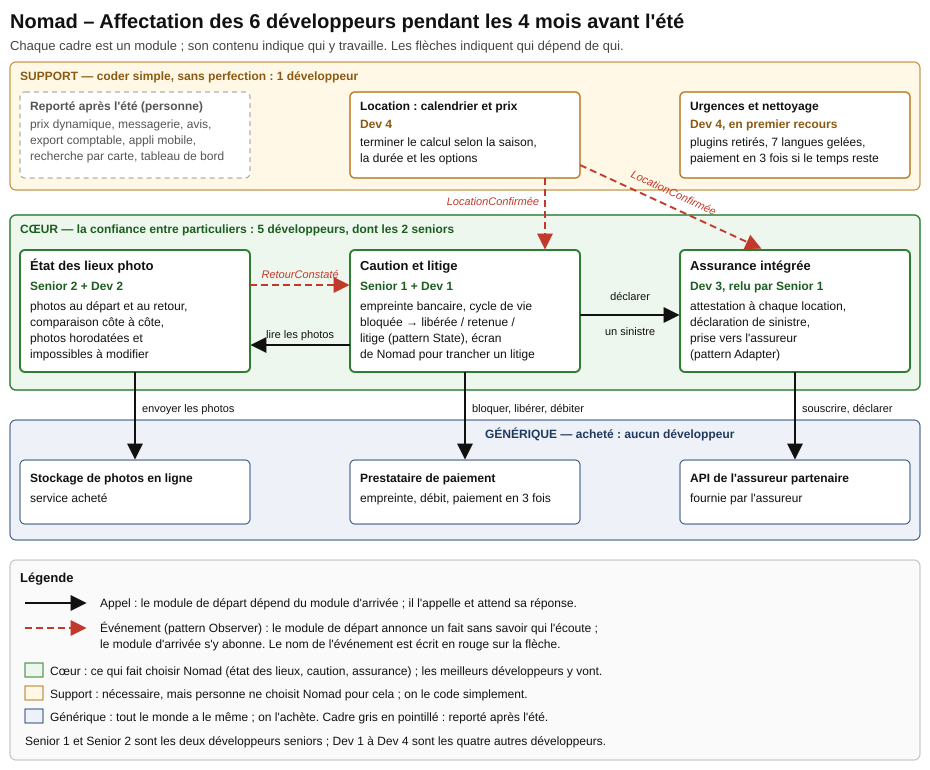
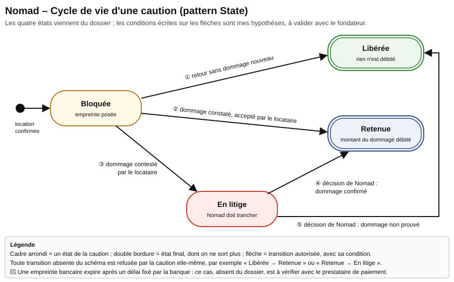

# Partie B — Mises en situation

## Usage de l'IA

J'ai utilisé l'assistant Claude (Anthropic), via l'outil Claude Code, pour trois tâches : extraire le texte brut du dossier Nomad afin de ne perdre aucun chiffre, refaire les calculs de semaines de développement et de charge, puis proposer une première version des tableaux et des deux schémas (dessinés en SVG). J'ai ensuite vérifié chaque total à partir des chiffres du dossier (2 × 7, 1 × 5, 1 × 6, 1 × 8 semaines), et j'ai marqué d'un **🤔** tous les prix, délais et volumes que le dossier ne donne pas. Le classement des chantiers, le choix des seniors, les patterns retenus et les refus relèvent de mon propre jugement.

## Situation 5 — Nomad (où mettre les développeurs)

### Ce que j'ai compris

* Nomad est une startup de location de camping-cars entre particuliers : **1 800 véhicules** et **9 000 locations l'an dernier**, concentrées sur l'été. J'arrive comme tech lead d'une équipe de **6 développeurs, dont 2 seniors**, et le fondateur me remet son backlog avec un constat : « on a 6 devs et on n'avance pas ».
* Pendant les 3 derniers mois, l'équipe a construit un **login maison** (2 développeurs pendant 7 semaines), un **moteur de template maison** pour les contrats en PDF (5 semaines), la **traduction du site en 8 langues** alors que **99 % des utilisateurs sont en France** (6 semaines), et un **système de plugins** pour des loueurs professionnels qui **n'existent pas encore** (8 semaines).
* Pendant ce temps, le calendrier de disponibilité et le calcul du prix, sans lesquels aucune location n'est possible, n'ont reçu qu'**un demi-développeur, « entre deux urgences »**.
* Or le fondateur dit lui-même ce qui fait gagner Nomad : « la confiance entre particuliers : **l'état des lieux, la caution, l'assurance**. Le reste, tout le monde l'a. » Aucun de ces trois sujets n'a été commencé, alors que **l'été commence dans 4 mois**.
* Le problème n'est donc pas la vitesse de l'équipe, mais l'endroit où va son temps. Mon travail consiste par conséquent à classer le métier, à arrêter ce qui ne sert pas, puis à mettre les meilleurs développeurs sur le cœur avant l'été.

---

### Ce qui manque : hypothèses et informations manquantes

Le dossier laisse plusieurs points flous. Pour chacun, je cite l'extrait concerné, je pose une hypothèse et j'indique ce qui changerait si elle se révélait fausse. Dans tout le document, le symbole 🤔 signale une information incertaine : elle ne figure pas dans le dossier et reste à valider avec le fondateur ou les fournisseurs concernés. Les cinq premiers portent sur l'équipe et sur les trois derniers mois.

| Information manquante (extrait du dossier) | Hypothèse retenue | Ce qui change si elle est fausse |
|---|---|---|
| « Sur quoi les 6 devs ont passé **les 3 derniers mois** » : les chantiers listés ne couvrent pas tout ce temps. | Trois mois font 13 semaines, soit 78 semaines de développement. Les chantiers listés en représentent 39,5 ; je suppose que le reste est parti dans les urgences, les corrections et la maintenance **🤔**. | Si ce reste est parti dans d'autres chantiers, il faut les classer aussi. En revanche, le constat « 0 semaine sur le cœur » ne change pas. |
| « 6 développeurs, **dont 2 seniors** » : le dossier ne dit pas sur quoi travaillaient les seniors. | Les deux seniors peuvent être réaffectés dès maintenant, quel que soit leur chantier passé. | Si l'un d'eux est le seul à connaître le login maison, il faut prévoir quelques heures par semaine pour sa maintenance. |
| « 1 dev, à moitié, **entre deux urgences** » sur le calendrier et le prix | Le calendrier et le calcul du prix existent déjà en production, mais restent incomplets **🤔**. | S'ils n'existent pas du tout, le Dev 4 ne suffira pas et il faudra lui adjoindre un second développeur. |
| Le paiement d'une location n'est jamais décrit. | Le paiement en une fois existe déjà, par l'intermédiaire d'un prestataire de paiement **🤔**, puisque Nomad a encaissé 9 000 locations. | S'il n'existe pas, le paiement devient la première priorité, avant même la caution. |
| « Un système de login maison » : est-il en production ? | Oui : tous les utilisateurs se connectent déjà avec lui **🤔**. | S'il n'est pas encore en production, on l'abandonne tout de suite au profit d'un service acheté. |

Les cinq hypothèses suivantes portent sur le cœur et sur l'été.

| Information manquante (extrait du dossier) | Hypothèse retenue | Ce qui change si elle est fausse |
|---|---|---|
| « **Caution automatique (empreinte bancaire)** » : combien de temps une empreinte reste-t-elle valable ? | Une empreinte bancaire n'est garantie que quelques jours, selon les banques **🤔**. Or une location d'été dure souvent plus d'une semaine **🤔**. | Si l'empreinte tient toute la location, le cycle de vie de la caution se simplifie. Sinon, il faut la renouveler ou la remplacer par un débit suivi d'un remboursement, ce qui se décide avec le prestataire de paiement. |
| « Assurance intégrée (partenaire : un assureur, **API disponible**) » | L'API permet de souscrire une assurance pour chaque location, d'obtenir une attestation et de déclarer un sinistre **🤔**. | Si elle ne permet que la souscription, les sinistres sont déclarés à la main par Nomad, ce qui reste acceptable pour l'été. |
| « État des lieux photo au départ et au retour, **avec comparaison** » | La comparaison consiste à afficher côte à côte la photo du départ et celle du retour ; aucune détection automatique des rayures n'est prévue. | Si le fondateur attend une détection automatique, elle ne sera pas prête pour l'été (voir les refus). |
| « 9 000 locations l'an dernier, **surtout l'été** » | L'été couvre juin, juillet et août, et concentre 60 % des locations **🤔** ; l'activité croît de 50 % cette année **🤔**. | Avec une croissance trois fois plus forte, la conclusion du calcul de charge ne change pas (livrable 5). |
| « Le backlog (extrait, 22 demandes) […] **et 11 autres** » | Les 11 demandes absentes seront classées avec la même règle, lors d'un atelier d'une heure avec le fondateur. | Si l'une d'elles touche à la confiance (par exemple la vérification d'identité des locataires), elle rejoint le cœur. |

---

### Livrable 1 — Le classement cœur / support / générique

Le cours définit trois catégories. Le **cœur** est ce pour quoi un client choisit Nomad plutôt qu'un concurrent ; il reçoit les meilleurs développeurs. Le **support** est nécessaire, mais personne ne choisit Nomad pour lui ; on le code simplement. Le **générique** est ce que tout le monde a à l'identique ; on l'achète. Pour Nomad, le fondateur a donné lui-même le critère du cœur : la confiance entre particuliers.

Le premier tableau classe les cinq chantiers des trois derniers mois.

| Chantier des 3 derniers mois | Classement | Justification |
|---|---|---|
| Login maison avec mot de passe oublié et double authentification par SMS (2 devs, 7 semaines) | **Générique** | Aucun locataire ne choisit Nomad pour son écran de connexion, et des services d'authentification prêts à l'emploi font la même chose. |
| Générateur de PDF de contrat avec moteur de template maison (1 dev, 5 semaines) | **Générique** pour le moteur, support pour le texte du contrat | Le contrat est nécessaire, mais transformer un modèle en PDF est un problème que des bibliothèques existantes règlent déjà. |
| Traduction du site en 8 langues (1 dev, 6 semaines) | **Générique**, et inutile aujourd'hui | Les outils de traduction existent tout faits, et 99 % des utilisateurs sont en France. |
| Système de plugins pour les loueurs professionnels (1 dev, 8 semaines) | **Support**, et inutile aujourd'hui | Il sert à étendre la plateforme, pas à créer la confiance, et aucun loueur professionnel n'existe encore. |
| Calendrier de disponibilité et calcul du prix selon la saison, la durée et les options (1 dev à mi-temps) | **Support** | Sans lui, aucune location n'est possible ; pourtant, tous les concurrents en ont un, donc il doit être fiable et simple, sans plus. |

Le deuxième tableau classe les demandes du backlog qui touchent directement la location et la confiance.

| Demande du backlog | Classement | Justification |
|---|---|---|
| État des lieux photo au départ et au retour, avec comparaison | **Cœur** | Le fondateur le cite en premier comme ce qui fait gagner Nomad contre ses concurrents. |
| Caution automatique (empreinte bancaire) | **Cœur** | Elle est citée par le fondateur ; l'empreinte elle-même est fournie par le prestataire de paiement, mais ses règles et son cycle de vie sont propres à Nomad. |
| Assurance intégrée (partenaire assureur, API disponible) | **Cœur** | Elle est citée par le fondateur ; le contrat d'assurance est acheté à l'assureur, mais son intégration dans chaque location et dans les litiges est propre à Nomad. |
| Avis et notes | **Support** | Les avis renforcent la confiance, mais « tout le monde l'a » ; une version simple suffit. |
| Messagerie entre loueur et locataire | **Générique** | Tous les sites de location en ont une, et des services de messagerie à intégrer existent ; il faudra seulement conserver l'historique, utile en cas de litige. |
| Paiement en 3 fois | **Générique** | Il est fourni par un prestataire externe, comme le montre le dossier, qui annonce déjà un changement de prestataire. |

Le troisième tableau classe les autres demandes, qui servent surtout les loueurs ou la recherche.

| Demande du backlog | Classement | Justification |
|---|---|---|
| Prix dynamique selon la demande, « comme les hôtels » | **Support** | Il affine un prix qui existe déjà, mais aucun locataire ne choisit Nomad pour cela ; de plus, 9 000 locations par an donnent peu de données pour un calcul fiable **🤔**. |
| Export comptable pour les loueurs | **Support** | Il est utile aux loueurs, surtout aux professionnels, qui n'existent pas encore ; un simple fichier tableur suffit. |
| Appli mobile | **Support** | C'est un canal d'accès et non une différence ; un site web adapté au téléphone permet déjà de prendre les photos de l'état des lieux. |
| Recherche par carte | **Support**, avec un fond de carte **générique** acheté | La recherche est nécessaire, mais la carte elle-même s'achète auprès d'un fournisseur de cartes. |
| Tableau de bord loueur | **Support** | Il est utile, mais la partie qui compte avant l'été (l'état de la caution et de l'état des lieux) est construite avec le cœur. |
| Les 11 autres demandes | Non classées | Le dossier ne les donne pas ; je les classerai avec la même règle, avec le fondateur (hypothèse ci-dessus). |

Ce classement fait apparaître un fait gênant : **trois éléments seulement sont dans le cœur, et ce sont les trois que personne n'a commencés.**

---

### Livrable 2 — Le bilan des 3 derniers mois

Les chiffres du dossier permettent de compter les semaines de développement (une semaine-dev correspond au travail d'un développeur pendant une semaine) :

```
Login maison           2 devs × 7 semaines            = 14    semaines-dev   générique
Moteur de PDF          1 dev  × 5 semaines            =  5    semaines-dev   générique
Traduction 8 langues   1 dev  × 6 semaines            =  6    semaines-dev   générique
Système de plugins     1 dev  × 8 semaines            =  8    semaines-dev   support
Calendrier et prix     1 dev  × 50 % × 13 semaines    =  6,5  semaines-dev   support 🤔
---------------------------------------------------------------------------------------
Total identifié                                        = 39,5 semaines-dev
  dont générique 25 (63 %), support 14,5 (37 %), cœur 0 (0 %)
Capacité théorique : 6 devs × 13 semaines              = 78   semaines-dev
Reste non décrit par le dossier (urgences ?)           = 38,5 semaines-dev 🤔
```

Le résultat est sans appel : **sur le temps dont on connaît l'usage, près des deux tiers sont allés dans le générique, et rien n'est allé dans le cœur.** De plus, la moitié de la capacité de l'équipe n'est décrite nulle part, ce qui confirme le poids des urgences évoquées par le dossier.

#### Ce que j'aurais acheté au lieu de coder

Pour chaque chantier, j'indique ce qui aurait dû être acheté ou simplement non fait, son coût approximatif et le temps libéré. Les prix sont des **ordres de grandeur à confirmer 🤔**, car ils dépendent du nombre d'utilisateurs actifs, que le dossier ne donne pas.

| Chantier | Ce que j'aurais fait à la place | Coût estimé | Intégration | Semaines-dev libérées |
|---|---|---|---|---|
| Login maison | Acheter un service d'authentification, du type Auth0 cité par le cours, qui inclut le mot de passe oublié et la double authentification. | De gratuit à quelques centaines d'euros par mois selon le nombre d'utilisateurs, plus quelques centimes par SMS **🤔** | 1 semaine-dev | 14 − 1 = **13** |
| Moteur de PDF | Utiliser une bibliothèque libre qui transforme une page HTML en PDF, ou un service de génération de documents. | De 0 à environ 50 € par mois **🤔** | 1 semaine-dev | 5 − 1 = **4** |
| Traduction en 8 langues | Ne rien acheter et ne pas traduire ; seulement ranger les textes dans un fichier à part (voir le livrable 3). | 0 € | 0,5 semaine-dev | 6 − 0,5 = **5,5** |
| Système de plugins | Ne rien acheter et ne pas le construire tant qu'aucun loueur professionnel ne le demande. | 0 € | 0 | **8** |
| Calendrier et prix | Rien : c'est du support propre à Nomad, il se code, mais simplement. | — | — | 0 |

Au total, **environ 30 semaines-dev auraient été libérées**, soit plus de deux développeurs à plein temps pendant les trois mois. En face, les achats auraient coûté quelques milliers d'euros par an **🤔**. Si l'on retient un coût chargé de 2 500 € par semaine-dev **🤔**, ces 30 semaines représentent environ 75 000 €. Par conséquent, coder le générique n'a pas seulement retardé le cœur : cela a aussi coûté plus cher que de l'acheter.

---

### Livrable 3 — YAGNI et portes ouvertes

Le principe YAGNI (« You Aren't Gonna Need It », on n'en aura pas besoin) rappelle que ce qui est construit « au cas où » arrive rarement, et jamais sous la forme imaginée. Le tableau suivant reprend les chantiers des trois derniers mois, indique s'ils étaient nécessaires, ce qu'ils coûtent maintenant à maintenir, et ce que je décide.

| Chantier | Était-il nécessaire ? | Ce qu'il coûte maintenant | Ma décision |
|---|---|---|---|
| Plugins pour les loueurs professionnels | **Non** : « aucun loueur pro n'existe encore ». | Une interface promise à des développeurs extérieurs doit rester stable ; chaque modification de la location ou de la caution doit donc la préserver, et le code de tiers ouvre une faille de sécurité potentielle. | Je le **retire du code** avant l'été, car personne ne l'utilise. |
| Traduction en 8 langues | **Non** : 99 % des utilisateurs sont en France. | Chaque nouvel écran (état des lieux, caution, assurance) devrait être traduit 8 fois ; de plus, un contrat ou une attestation d'assurance mal traduits engagent Nomad juridiquement **🤔**. | Je **gèle** les 7 langues étrangères : elles sont masquées, et les nouveaux écrans sont rédigés en français seulement. |
| Login « plus beau que Google » | **En partie** : une connexion était nécessaire, mais pas une connexion maison. | Nomad stocke lui-même les mots de passe, donc toute faille est de sa responsabilité ; il paie aussi les SMS et corrige seul chaque problème de sécurité. | Je le **garde jusqu'à la fin de l'été**, car le remplacer en pleine saison mettrait en jeu la connexion de tous ; ensuite, je le remplace par un service acheté. |
| Moteur de template maison pour les contrats | **En partie** : le contrat en PDF est nécessaire, mais pas un moteur maison. | Le contrat devra changer avant l'été pour mentionner la caution et l'assurance **🤔** ; or seul son auteur maîtrise le moteur. | Je le **garde sans le faire évoluer** au-delà de ces ajouts, puis je le remplace par une bibliothèque après l'été. |

#### Les portes ouvertes : peu chères et utiles

YAGNI ne veut pas dire « ne rien prévoir ». Le cours appelle « portes ouvertes » les décisions qui ne coûtent presque rien aujourd'hui et qui coûteraient très cher à rattraper plus tard. Dans les chantiers passés, deux idées en étaient, même si leur réalisation a été trop lourde ; deux autres sont à ouvrir maintenant, pendant la construction du cœur.

| Porte ouverte | Coût | Ce qu'elle évite plus tard |
|---|---|---|
| **Les textes du site rangés dans un fichier à part**, au lieu d'être écrits dans le code. C'était la seule partie utile du chantier de traduction. | Quelques jours, au lieu de 6 semaines | Le jour où Nomad s'ouvre à l'Espagne ou à l'Allemagne, on ajoute un fichier de traduction au lieu de reprendre tous les écrans. |
| **Le texte du contrat séparé du code**, sous forme de modèle. C'était la bonne idée du chantier PDF, mais un moteur maison était inutile. | Quelques jours avec une bibliothèque existante | Le fondateur ou un juriste peut modifier une clause sans attendre un développeur. |
| **Un journal « qui a fait quoi, quand »** sur chaque caution, chaque état des lieux et chaque décision de litige. | Une table et une ligne de code par action | Le jour d'un litige entre deux particuliers, Nomad peut prouver qui a validé quoi, ce qui est au centre de la confiance. |
| **Une prise devant chaque fournisseur** : l'assureur et le prestataire de paiement (voir le livrable 7). | Une petite classe par fournisseur | Le jour où le prestataire du paiement en 3 fois change, ce que le dossier annonce déjà, on écrit un fichier au lieu de reprendre la location. |

À l'inverse, je **n'ouvre pas** la porte des devises : le prix accompagné de sa devise est utile pour une entreprise qui vendra hors de la zone euro, or 99 % des utilisateurs de Nomad sont en France et rien n'annonce une sortie de la zone euro.

---

### Livrable 4 — L'affectation des 6 développeurs pour les 4 mois avant l'été

Quatre mois représentent environ 17 semaines, soit **102 semaines-dev** de capacité théorique. Si les urgences en consomment 20 % **🤔**, il reste environ 80 semaines-dev utiles. Je les répartis selon la règle du cours : **le cœur reçoit les meilleurs développeurs, le support est codé simplement, et le générique s'achète.** Par conséquent, cinq développeurs sur six, dont les deux seniors, travaillent sur le cœur.

| Développeur | Chantier pendant 4 mois | Pourquoi ce choix |
|---|---|---|
| **Senior 1** | Caution et litige : empreinte bancaire, cycle de vie complet, écran permettant à Nomad de trancher un litige. Il relit aussi le travail du Dev 3 sur l'assurance. | C'est le sujet le plus risqué : il bloque l'argent d'un particulier sur sa carte, et une caution retenue à tort ou une empreinte expirée avant le retour détruirait exactement la confiance que vend le fondateur. |
| **Dev 1** | En binôme avec le Senior 1 : les écrans de la caution, l'écran de litige et les notifications. | Il apprend le cœur aux côtés d'un senior, ce qui évite qu'une seule personne le connaisse. |
| **Senior 2** | État des lieux photo : prise des photos sur le téléphone, envoi fiable même avec un mauvais réseau, photos horodatées et impossibles à modifier, comparaison côte à côte. | C'est le point dur du calcul de charge (livrable 5) et c'est la preuve sur laquelle reposent la caution et le litige : sans photo du départ, aucune retenue n'est défendable. |
| **Dev 2** | En binôme avec le Senior 2 : les écrans de prise de photos et de comparaison. | Même raison que pour le Dev 1. |
| **Dev 3** | Assurance intégrée : branchement de l'API de l'assureur, attestation à chaque location, déclaration de sinistre. Il est l'interlocuteur technique de l'assureur. | Le sujet est bien délimité derrière une prise (pattern Adapter), donc un développeur confirmé peut le mener, à condition qu'un senior relise ses choix. |
| **Dev 4** | Support : terminer le calendrier et le calcul du prix, traiter les urgences en premier recours, retirer les plugins et geler les langues ; enfin, brancher le paiement en 3 fois s'il reste du temps. | Le calendrier est indispensable à chaque location, mais c'est du support ; de plus, un développeur dédié aux urgences protège les cinq autres des interruptions qui ont freiné l'équipe. |

Le schéma suivant montre cette affectation sur les modules : il indique qui travaille sur quoi, qui dépend de qui, et si le lien est un appel ou un événement.



Trois choix de ce schéma méritent une explication :

* **La location annonce « LocationConfirmée » par un événement**, auquel la caution et l'assurance s'abonnent. Ainsi, le Dev 4 peut terminer le calendrier et le prix sans toucher au code des modules du cœur, et inversement.
* **L'état des lieux annonce « RetourConstaté »**, et c'est la caution qui décide de la suite (libérer, retenir ou ouvrir un litige). L'état des lieux reste donc une simple preuve, qui ne connaît pas les règles d'argent.
* **Le générique est acheté et appelé à travers une prise** : aucun développeur n'y est affecté, et le code du cœur ne connaît le nom d'aucun fournisseur.

#### Le calendrier des 4 mois

La règle de ce calendrier est de valider les règles avant de coder, puis d'essayer le cœur sur de vraies locations avant la haute saison.

| Période | Ce qui se passe |
|---|---|
| Semaines 1 et 2 | Les règles métier du livrable 6 sont validées avec le fondateur et avec l'assureur, et la durée de validité d'une empreinte est vérifiée auprès du prestataire de paiement. En parallèle, le Dev 4 retire les plugins et gèle les langues. |
| Semaines 3 à 10 | Les trois modules du cœur sont construits et mis en production au fur et à mesure, mais restent masqués aux utilisateurs. |
| Semaines 11 à 14 | Un pilote est mené avec une vingtaine de loueurs volontaires **🤔** sur de vraies locations, pendant la saison creuse. |
| Semaines 15 à 17 | Les défauts relevés pendant le pilote sont corrigés, puis l'envoi des photos est testé en charge ; enfin, plus aucune nouveauté n'est mise en production pendant les deux semaines qui précèdent l'été. |

---

### Livrable 5 — Les exigences de qualité du cœur et le calcul de charge de l'été

#### Un scénario chiffré pour chaque sujet du cœur

Chaque scénario suit le gabarit du cours : qui, quoi, quand, et une mesure observable. Les seuils marqués **🤔** sont des **cibles que je propose** au fondateur, car le dossier ne les fournit pas.

| #   | Sujet et attribut                              | Qui                                                                                                    | Quoi                                                                                                           | Quand                                                                                                       | Mesure observable                                                                                                                                                                                                                                                                             |
| --- | ---------------------------------------------- | ------------------------------------------------------------------------------------------------------ | -------------------------------------------------------------------------------------------------------------- | ----------------------------------------------------------------------------------------------------------- | --------------------------------------------------------------------------------------------------------------------------------------------------------------------------------------------------------------------------------------------------------------------------------------------- |
| QS1 | **État des lieux** : fiabilité de la preuve    | Un loueur et un locataire, sur le lieu de remise du camping-car, avec un réseau mobile faible **🤔.** | réalisent ensemble l'état des lieux du départ, soit 30 photos imposées **🤔**, puis le valident tous les deux | un samedi matin de juillet, quand environ 125 états des lieux sont envoyés chaque heure (calcul ci-dessous) | L'état des lieux est terminé en moins de 10 minutes dans 95 % des cas **🤔**. Aucune photo n'est perdue si le réseau coupe, car l'envoi reprend seul. Enfin, 100 % des photos sont horodatées et ne peuvent plus être modifiées après la validation.                                         |
| QS2 | **Caution** : exactitude de l'argent bloqué    | Le module Caution, pour le compte d'un locataire                                                       | bloque l'empreinte bancaire, puis la libère si aucun dommage nouveau n'est constaté                            | avant la remise des clés, puis au retour                                                                    | Aucune remise de clés n'a lieu sans empreinte confirmée. La libération est demandée à la banque moins d'une heure après la validation de l'état des lieux du retour **🤔**. Enfin, aucune caution n'est retenue sans dommage visible sur les photos du retour et absent de celles du départ. |
| QS3 | **Assurance** : disponibilité de l'intégration | Un locataire                                                                                           | confirme sa location et reçoit son attestation d'assurance                                                     | au moment de la confirmation, y compris lorsque l'API de l'assureur ne répond pas                           | L'attestation est reçue en moins de 30 secondes dans 95 % des cas **🤔**. Si l'API ne répond pas, la demande est relancée automatiquement et l'équipe est alertée en moins de 15 minutes **🤔**. Enfin, 100 % des départs disposent d'une attestation valide.                               |

#### Le calcul de charge de l'été

Le dossier ne donne que deux chiffres : 9 000 locations l'an dernier et 1 800 véhicules. Je pose donc les hypothèses suivantes, à valider avec le fondateur.

| Hypothèse | Valeur retenue |
|---|---|
| Part des locations réalisées pendant l'été (juin, juillet et août, soit 92 jours), puisque le dossier dit « surtout l'été » | 60 % **🤔** |
| Croissance de l'activité par rapport à l'an dernier | + 50 % **🤔** |
| Nombre de visites sur le site pour une location réservée, et nombre de requêtes par visite (valeur du cours) | 40 visites **🤔** et 15 requêtes |
| Part des départs et des retours qui ont lieu le samedi, sur 13 samedis d'été, et concentration sur la matinée (de 9 h à 13 h) | 40 % **🤔**, sur 4 heures |
| Nombre et poids des photos d'un état des lieux, sachant qu'il y en a un au départ et un au retour | 30 photos de 3 Mo **🤔** |

Le calcul se fait en trois étapes : les locations, puis les requêtes, puis les photos.

```
Locations de l'été   = 9 000 × 60 % × 1,5                       = 8 100 locations
Requêtes de l'été    = 8 100 × 40 visites × 15 requêtes          ≈ 4,9 millions
Moyenne              = 4,9 M / (92 jours × 86 400 s)            ≈ 0,6 req/s
Pic (× 10, le cours) = 0,6 × 10                                  ≈ 6 req/s

États des lieux      = 8 100 locations × 2                       = 16 200 sur l'été
Un samedi            = 16 200 × 40 % / 13 samedis                ≈ 500 états des lieux
Par heure (9 h-13 h) = 500 / 4                                   ≈ 125 par heure
Photos du samedi     = 500 × 30 photos × 3 Mo                    ≈ 45 Go en 4 heures
Débit entrant        = 45 000 Mo / 14 400 s                      ≈ 3 Mo/s, soit 1 photo/s
Stockage de l'été    = 16 200 × 30 × 3 Mo                        ≈ 1,5 To
Empreintes bancaires = 8 100 × 40 % / 13 samedis                 ≈ 250 le samedi
```

**Conclusion : le nombre de requêtes n'est pas un problème.** En effet, 6 requêtes par seconde au pic représentent vingt fois moins que les 130 requêtes par seconde qu'un serveur bien réglé tient, selon le cours. Les vrais points durs sont ailleurs, et ils justifient l'affectation des seniors :

* **l'envoi des photos depuis un parking**, avec un réseau faible : c'est là qu'une photo peut se perdre, et donc une preuve. Les photos doivent donc être compressées sur le téléphone, envoyées directement vers le stockage acheté et renvoyées automatiquement en cas de coupure ;
* **le stockage et la durée de conservation** : 1,5 To par été, à garder au moins jusqu'à la fin des litiges possibles, dont la durée est à fixer avec le fondateur **🤔** ;
* **les deux dépendances extérieures du samedi matin**, l'API de l'assureur et le prestataire de paiement : leur volume est faible (250 empreintes), mais une panne de l'une d'elles bloque des départs.

---

### Livrable 6 — Les règles métier du cœur

Chaque ligne énonce une seule règle. La colonne « Source » distingue les faits du dossier de mes déductions :

* **Dossier** : la règle est écrite dans le dossier ;
* **Déduite** : la règle se lit dans le dossier, mais n'y est pas écrite explicitement ;
* **🤔** : la règle est une hypothèse que je pose, faute d'information, et elle doit être validée.

La dernière colonne indique avec qui la vérifier : le **fondateur** pour les règles de Nomad, l'**assureur** pour tout ce qui touche à la couverture et aux sinistres. Les premières règles portent sur la caution.

| # | Règle | Source | À vérifier avec |
|---|---|---|---|
| C1 | Chaque location donne lieu à une caution, prise sous forme d'empreinte bancaire, sans débit immédiat. | Dossier | — |
| C2 | Une caution est bloquée, libérée, retenue ou en litige. | Dossier | — |
| C3 | Les clés ne sont pas remises tant que l'empreinte n'est pas confirmée. | Déduite | Fondateur |
| C4 | Le montant de la caution est égal à la franchise de l'assurance. | 🤔 | Fondateur et assureur |
| C5 | Si l'empreinte expire avant le retour, elle est renouvelée automatiquement, ou bien remplacée par un débit remboursé ensuite. | 🤔 | Fondateur et prestataire de paiement |
| C6 | Si le retour ne révèle aucun dommage nouveau, la caution est libérée automatiquement. | Déduite | Fondateur (délai de libération) |
| C7 | Une caution libérée ou retenue ne change plus jamais d'état. | Déduite | Fondateur |

Les règles suivantes portent sur l'état des lieux.

| # | Règle | Source | À vérifier avec |
|---|---|---|---|
| E1 | Un état des lieux en photos est réalisé au départ et au retour de chaque location. | Dossier | — |
| E2 | Les photos du retour sont comparées à celles du départ. | Dossier | — |
| E3 | Chaque état des lieux contient une liste de vues imposées : les quatre côtés, l'intérieur, le compteur kilométrique et les niveaux. | 🤔 | Fondateur et assureur |
| E4 | Le loueur et le locataire valident tous les deux l'état des lieux sur place ; après validation, plus aucune photo ne peut être ajoutée ni modifiée. | 🤔 | Fondateur |
| E5 | Une location ne démarre pas sans état des lieux de départ validé. | Déduite | Fondateur |
| E6 | Le loueur dispose de 24 heures après le retour pour signaler un dommage qu'il n'aurait pas vu sur place. | 🤔 | Fondateur et assureur |

Les règles suivantes portent sur le litige.

| # | Règle | Source | À vérifier avec |
|---|---|---|---|
| L1 | Une caution peut se trouver « en litige ». | Dossier | — |
| L2 | Un litige s'ouvre lorsque le locataire conteste un dommage signalé par le loueur. | 🤔 | Fondateur |
| L3 | Pendant le litige, l'argent reste bloqué, y compris si l'empreinte doit être renouvelée (règle C5). | 🤔 | Fondateur et prestataire de paiement |
| L4 | Nomad tranche le litige au vu des photos du départ et du retour, et sa décision est enregistrée dans le journal. | 🤔 | Fondateur |
| L5 | Un litige est tranché en 15 jours au plus. | 🤔 | Fondateur |
| L6 | Si le dommage dépasse le montant de la caution, il est déclaré comme sinistre à l'assureur. | 🤔 | Assureur |

Les dernières règles portent sur l'assurance.

| # | Règle | Source | À vérifier avec |
|---|---|---|---|
| A1 | L'assurance est fournie par un assureur partenaire, et souscrite par son API. | Dossier | — |
| A2 | Chaque location est couverte par l'assurance du partenaire, sans démarche du locataire. | Déduite (« intégrée ») | Assureur |
| A3 | Une location ne démarre pas sans attestation d'assurance valide. | Déduite | Fondateur et assureur |
| A4 | Le conducteur doit remplir des conditions d'âge et d'ancienneté de permis, vérifiées avant la souscription. | 🤔 | Assureur |
| A5 | Le prix de l'assurance dépend de la durée de la location et de la valeur du véhicule. | 🤔 | Assureur |
| A6 | Un sinistre est déclaré à l'assureur dans un délai fixé par son contrat, par exemple 5 jours ouvrés. | 🤔 | Assureur |
| A7 | L'annulation d'une location annule l'assurance associée, et son remboursement suit les conditions de l'assureur. | 🤔 | Assureur |

Deux de ces règles incertaines pèsent particulièrement sur l'architecture :

* **C5 décide de la forme du cycle de vie de la caution.** Si une empreinte expire avant la fin d'une location de deux semaines, il faut un mécanisme de renouvellement, et le pattern State du livrable 7 doit le prévoir.
* **C4 relie la caution et l'assurance.** Si la caution est égale à la franchise, les deux modules doivent partager cette valeur, qui doit venir de l'assureur et non être écrite en dur dans le code.

---

### Livrable 7 — Les patterns du cœur

Le dossier pose trois problèmes précis. Pour chacun, je reprends le plan du cours : le problème, la solution et le cas où il ne faut pas utiliser le pattern.

#### L'assureur a une API → **Adapter**

| Problème | Solution | Quand ne pas l'utiliser |
|---|---|---|
| L'API de l'assureur a son propre format (ses noms de champs, ses codes d'erreur, ses identifiants de contrat), que Nomad ne contrôle pas. Si le module Assurance l'appelle directement partout, un changement de version de l'API, ou un second assureur, oblige à reprendre tout le module. | Le métier ne parle qu'à une « prise » qui lui ressemble : `souscrire(location)` et `declarerSinistre(litige)`. Un petit traducteur, `AssureurPartenaireAdapter`, convertit ces appels dans le format de l'assureur. Dans les tests, on branche une `FausseAssurance`. | Si Nomad contrôlait les deux côtés, il suffirait de les faire parler le même format. Ici, l'API appartient à l'assureur : l'Adapter est donc justifié. |

Ce que cela rapporte à Nomad : les tests de la caution et du litige tournent sans appeler le vrai assureur, et le jour où Nomad met deux assureurs en concurrence, il écrit un nouveau traducteur au lieu de reprendre le module.

#### Le paiement en 3 fois change de prestataire → **Strategy**

| Problème | Solution | Quand ne pas l'utiliser |
|---|---|---|
| Une location peut se payer comptant ou en 3 fois, et chaque mode suit une règle différente : un seul débit d'un côté, trois échéances et des frais de l'autre. De plus, le dossier annonce que le prestataire du paiement en 3 fois va changer. Avec une suite de `if` dans la location, chaque changement risque de casser le paiement comptant. | Chaque mode de paiement devient une petite classe avec la même méthode, `encaisser(location)` : `PaiementComptant`, `PaiementEn3FoisPrestataireA`. La location choisit la stratégie au moment du paiement, sans savoir laquelle est derrière. Changer de prestataire revient à écrire `PaiementEn3FoisPrestataireB`, sans modifier aucune ligne existante. | S'il n'y avait qu'un seul mode de paiement, qui ne bouge jamais, un simple appel suffirait. Ici, il y a déjà deux modes, et l'un change de prestataire avant même d'exister. |

Chaque stratégie s'appuie elle-même sur le prestataire de paiement acheté ; par conséquent, la location ne connaît ni le mode ni le nom du prestataire.

#### La caution a un cycle de vie → **State**

| Problème | Solution | Quand ne pas l'utiliser |
|---|---|---|
| Une caution passe par quatre états (bloquée, libérée, retenue, litige). Si chaque écran vérifie lui-même le statut avec des `if`, un jour un bouton débite une caution déjà libérée, ou libère une caution en litige ; c'est exactement l'erreur qui détruit la confiance. | Les transitions autorisées sont écrites une seule fois, et la caution refuse elle-même toute transition interdite, d'où que vienne la demande (écran, litige ou tâche automatique). | Si la caution n'avait que deux états, par exemple « bloquée » ou « libérée », un booléen suffirait. Ici, elle en a quatre, avec des règles d'argent : State est justifié. |

Les transitions autorisées sont écrites une seule fois dans le code :

```js
// Les transitions autorisées de la caution, écrites UNE fois
const transitions = {
  bloquee:  ["liberee", "retenue", "litige"],
  litige:   ["liberee", "retenue"],   // décision de Nomad
  liberee:  [],                        // état final
  retenue:  [],                        // état final
};
caution.passerA("retenue"); // refusé si la caution est déjà libérée
```

Le schéma suivant représente ce cycle de vie ; les conditions écrites sur les flèches reprennent les règles C6, L2 et L4 du livrable 6.



---

### Livrable 8 — La note au fondateur

> **Objet : ce qui sera prêt pour l'été, et la règle pour que cela ne se reproduise pas**
>
> Vos développeurs travaillent, mais pas sur ce qui fait gagner Nomad : en 3 mois, 25 semaines de travail sont allées au login, au PDF et aux 8 langues, et aucune à l'état des lieux, à la caution ou à l'assurance.
>
> **Prêt pour l'été** : l'état des lieux en photos avec comparaison, la caution par empreinte bancaire jusqu'au litige, l'assurance intégrée à chaque location, et le calendrier terminé. Cinq développeurs sur six, dont les deux seniors, y travaillent, et un pilote avec une vingtaine de loueurs aura lieu un mois avant l'été.
>
> **Pas prêt** : le prix dynamique, la messagerie, les avis, l'export comptable, l'appli mobile, la carte et la détection automatique des dommages ; le paiement en 3 fois seulement s'il reste du temps. Les plugins sont retirés et les 7 langues étrangères gelées.
>
> **J'ai besoin de vous** dans les deux premières semaines pour valider les règles de caution et de litige, et pour rencontrer l'assureur.
>
> **La règle** : tout chantier de plus d'une semaine est d'abord classé avec vous. Le générique s'achète, le support reçoit une version simple et une durée fixée d'avance, le cœur reçoit les seniors, et rien ne se fait « au cas où ». Chaque mois, je vous montre la répartition des semaines : au moins la moitié doit aller au cœur.

---

### Ce que je refuse de faire, et pourquoi

| Je refuse de… | Parce que… |
|---|---|
| laisser l'équipe coder une nouvelle brique générique (messagerie, carte, paiement en 3 fois maison), | ces briques s'achètent, et les 30 semaines-dev perdues sur le login, le PDF et les traductions montrent ce que coûte le contraire (livrable 2). |
| démarrer le prix dynamique, l'appli mobile ou la messagerie avant l'été, | ce sont du support ou du générique, alors que le cœur n'est pas commencé et que l'été arrive dans 4 mois. |
| promettre une détection automatique des dommages sur les photos pour l'été, | c'est un chantier long et incertain ; une comparaison côte à côte, validée par les deux parties, suffit à fonder une retenue ou un litige. |
| fixer seul le montant de la caution, les délais de litige ou les conditions d'assurance, | ce sont des règles de Nomad et de l'assureur, qui engagent de l'argent et la confiance des particuliers ; je les marque 🤔 et je les fais valider (livrable 6). |
| remplacer le login maison avant l'été, | il fonctionne, et le changer en pleine saison mettrait en jeu la connexion de tous les utilisateurs ; je le remplace donc après l'été. |
| continuer à maintenir le système de plugins, | aucun loueur professionnel n'existe, et chaque évolution du cœur devrait préserver une interface que personne n'utilise. |
| laisser les seniors absorber les urgences, | c'est précisément ce qui a laissé le calendrier « entre deux urgences » ; le Dev 4 les traite en premier recours, et les seniors ne sont sollicités qu'en dernier ressort. |
